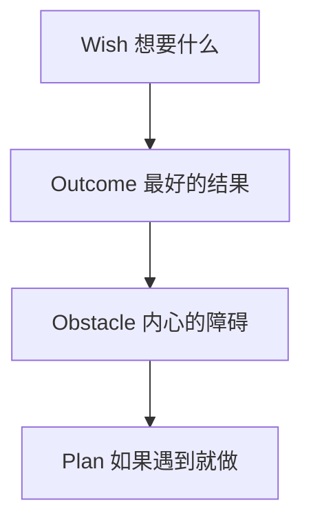

## Q
你想转岗做后端，一想到拿到 offer 的样子就兴奋，越想越美，反而一周没碰刷题。光想象成功为什么会让人松劲？换成什么想法顺序，才会推动你真的动手？

## A
**心理对比（mental contrasting，配上应对计划就是 WOOP）：想完成功的样子，再想横在中间最大的那个障碍，并写好「如果遇到它，我就……」，才会推动行动。**

**故事。** Duckworth、Oettingen 等人在美国一所城市公立中学做了个实验：77 个刚升入中学的五年级学生，随机分成两组，各上 3 次、每次 1 小时、4 到 5 人一组的小课。两组都先写下一个学业愿望和最好的结果。实验组接着找出自己心里的障碍，写成「如果碰到它，我就……」；对照组改想第二个好结果。到第三个季度末，校正基线后实验组平均成绩 80.29 分，对照组 78.13 分；准时到校 43.28 天对 42.38 天；老师给的品行评分 3.67 对 3.42（满分 5）。到第四个季度，差距缩小，不再显著。

- **证据 · 中：** 最早的线索来自 Oettingen 和 Mayer 2002 年的发现：毕业生里，越爱幻想求职顺利的人，两年后投的申请越少、拿到的 offer 也越少。2021 年 Wang 等汇总 21 项研究（15,907 人），心理对比加执行计划对目标达成的效应量 g=0.34，小到中等，发表偏倚可能让它偏高。
- **动手：** 今晚写 WOOP 四行：想要什么（每周刷 5 题）；最好的结果；心里最大的障碍（比如下班累了就刷手机）；「如果下班后想刷手机，我就先做一题再说」。
