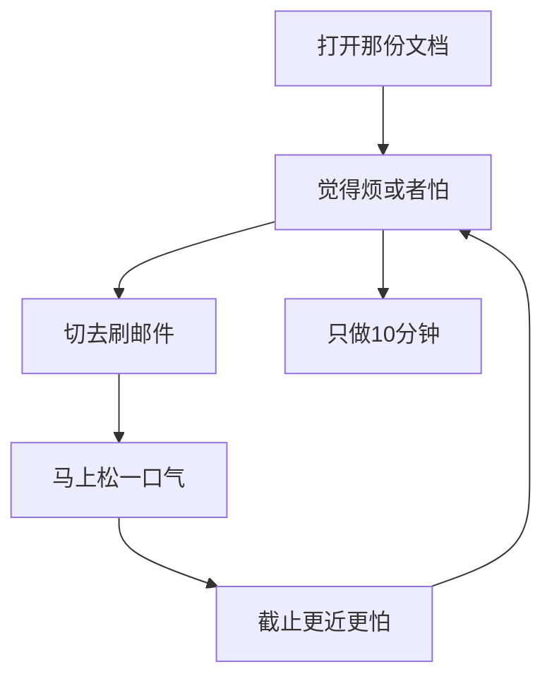

## Q
绩效自评下周五截止。你每次打开文档，两分钟后就切去看邮件、刷新闻。你知道它重要。真正拖住你的是什么？

## A
**拖延（procrastination）：拖的不是时间，是那件事带来的不舒服；先管住情绪，或把任务切小到不吓人。**

**故事。** 2010 年，加拿大 Carleton 大学的 Wohl、Pychyl 和 Bennett 跟踪了一百多名大一学生的两次期中考试。第一次考前，学生报告自己拖了多久才复习，事后有多原谅自己。到第二次期中考前：越原谅自己上次拖延的人，这次拖得越少，两次考试之间的负面情绪也更少，第二次的成绩更好。负面情绪是中间那一环：自责让复习更难受，下次就更想躲。

- **证据 · 强：** Steel 2007 年汇总 691 个相关系数，拖延最稳定的预测因素是任务让人反感、回报来得晚、不信自己能做成、冲动。Tice 等人 2001 年的实验里，让心情差的人相信心情暂时改不了，他们就不再拿无关的事拖。Wohl 的研究是相关数据，全靠自评。
- **动手：** 下次打开拖着的文档，先写一句「我烦，是因为不知道从哪开始」，再定 10 分钟计时，只列第一段的 3 个要点。拖了一天，就只问「下一步是什么」，不翻旧账。
