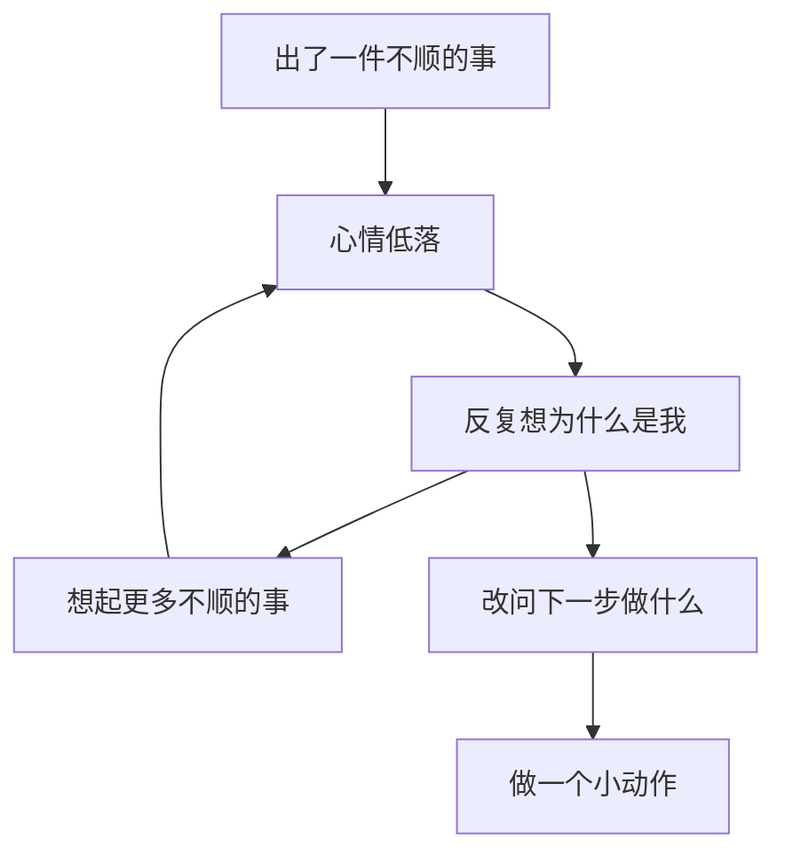

## Q
事情没做好，你躺着反复想「为什么我总这样」「别人怎么都比我顺」。想了一小时，心情更差，办法一个也没有。这种想法在研究里叫什么？它和认真反思差在哪？怎么停？

## A
**反刍（rumination，俗称内耗）：反复想自己为什么难受、哪里不行，却不走向任何行动。它不解决问题，只把低落拉长。**

**故事。** 1989 年旧金山大地震前两周，心理学家 Nolen-Hoeksema 碰巧给 137 名斯坦福学生测过情绪和应对习惯。震后 10 天和 7 周她再测一次：平时爱反刍的学生抑郁得更重、更久，把震前的情绪水平扣掉之后依然如此。后来的实验让低落的人反刍 8 分钟，他们给自己的问题想出的办法变得更差、更悲观；改成分心 8 分钟，心情回升。

- **证据 · 强：** 几十年的追踪和实验方向一致：反刍预测抑郁的出现和持续时间。
- **分辨：** 反思问「下一步怎么做」，想完有一个动作。反刍问「为什么是我」，想完只有更多的为什么。
- **动手：** 发现自己在同一件事上转到第三圈，写下一句「10 分钟内能做的下一步是什么」，然后去做。写不出，就起身换个地方，做 10 分钟别的事。
