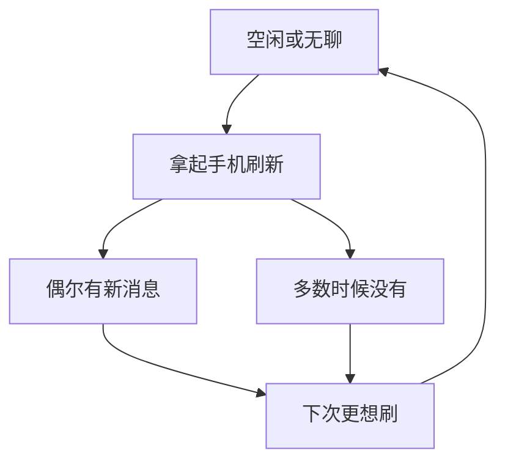

## Q
等编译的十几秒，你的手自己去刷邮件和朋友圈。十次里九次什么新东西都没有，可你停不下来。为什么「偶尔有」比「每次都有」更难戒？

## A
**间歇强化（variable-ratio reinforcement）：奖励来不来、第几次来都说不准的行为，做得最勤，奖励停了也最难停。老虎机和下拉刷新是同一个结构。**

**故事。** 2020 年 3 月，经济学家 Allcott、Gentzkow 和 Song 用广告招了约 2,000 名美国安卓用户，装上记录屏幕时间的 App，盯住 6 个最难放下的 App：Facebook、Instagram、Twitter、Snapchat、浏览器、YouTube。一组人可以给每个 App 设每日上限，到点就锁，多半不能当场解开：78% 的人设了，12 周里每天少用 22 分钟（16%）。另一组每少用 1 小时得 2.5 美元，3 周里每天少用 56 分钟；奖金停了以后的 3 周，仍少用 19 分钟。

- **证据 · 强：** Ferster 和 Skinner 1957 年的鸽子实验里，按不定次数给食的鸽子啄得又快又稳，几乎不停顿；从 Humphreys 1939 年起反复证实，间歇得到奖励的行为在奖励停掉后坚持得更久。把刷手机和老虎机归为同一结构是推论，Allcott 的实验测的是习惯和自控，不是刷新机制本身。
- **动手：** 今天在手机的屏幕使用时间里，给最常刷的 2 个 App 各设每天 30 分钟上限；邮件关掉推送，改成每天 11 点和 16 点各收一次。
