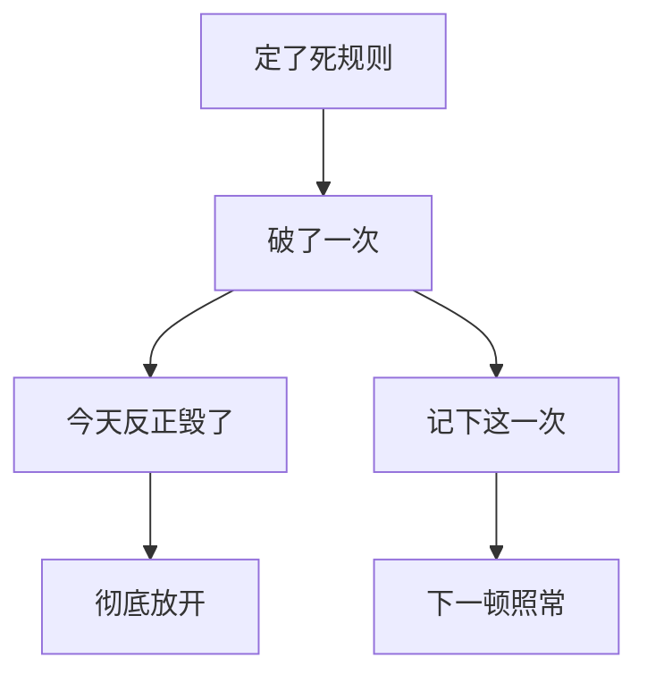

## Q
你定了「工作日不喝酒」，周三同事聚餐喝了一杯。回家路上你想「反正已经破了」，又开了两瓶啤酒。为什么一次小破戒常变成整晚放开？

## A
**破罐破摔效应（what-the-hell effect）：规则一旦破了，人容易想「今天反正毁了」，接着彻底放开；规则越死，越容易这样。**

**故事。** 1975 年，Herman 和 Mack 请女大学生参加一场「冰淇淋口味评测」。评测前，每人被随机安排先喝 0、1 或 2 杯奶昔。平时不节食的人很正常：喝过奶昔，冰淇淋吃得比没喝时少约 47%。长期节食的人反过来：喝过奶昔的，冰淇淋反而多吃约 66%。两人把这叫「反调节」（counter-regulation）：奶昔一下肚，当天的节食算是破了，再吃也就无所谓了。

- **证据 · 中：** 这个结果在实验室里重复过多次，但并不稳定，Dritschel 等人 1993 年就没能重现。Westenhoefer 等人 1999 年分析 54,517 名减重项目参与者：规则死板、全有或全无的人暴食更频繁、BMI 更高；规则有弹性的人一年后减重成功的更多，这是相关数据。
- **动手：** 把规则改成有余地的「工作日最多 1 杯」，并提前写好破了之后的一步：「破了就喝一杯水回家，第二天照常记录」。
