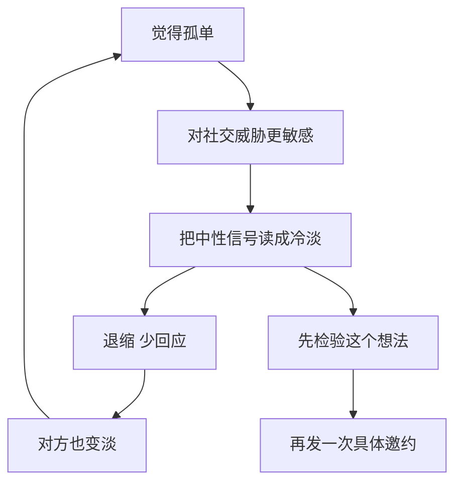

## Q
搬到新城市三个月，约了几个人都没成。有人回你一句「再看吧」，你读成「不想和我玩」，于是不再约。孤单的人读别人的信号，和不孤单的人有什么不同？怎么才能把这个循环打断？

## A
**孤独的自我强化循环（loneliness loop）：孤独让人对社交威胁更敏感，更容易把中性信号读成拒绝，于是更退缩，别人的回应也更淡，孤独又被证实。**

**故事。** Cacioppo 和 Hawkley 的芝加哥团队比较孤独和不孤独的成年人。Hawkley 等人让参加者连续 7 天每天被随机提醒 9 次，记下刚才的互动和心情：孤独的人觉得自己的互动更负面、更不满意，负面互动对心情的影响也更久。情绪斯特鲁普测验里，孤独者看到负面的社交词，被干扰得更厉害。Masi 等人 2011 年汇总 50 项减少孤独的干预，随机对照的里面，最成功的一类是帮人纠正对社交的错误想法，其余几类是练社交技巧、给支持、增加接触机会。

- **证据 · 强：** Holt-Lunstad 等人 2010 年汇总 148 项研究、308,849 人：关系更好的人活得更久的概率高约 50%（OR 1.50），量级与已知的风险因素相当。注意这是关系质量的数据，不等于孤独的因果效应。
- **动手：** 下次把别人的回复读成「他不想」之前，写下另外三种解释（忙、随口说说、等我再约）。48 小时内再发一次具体邀约：时间、地点、一件事。
