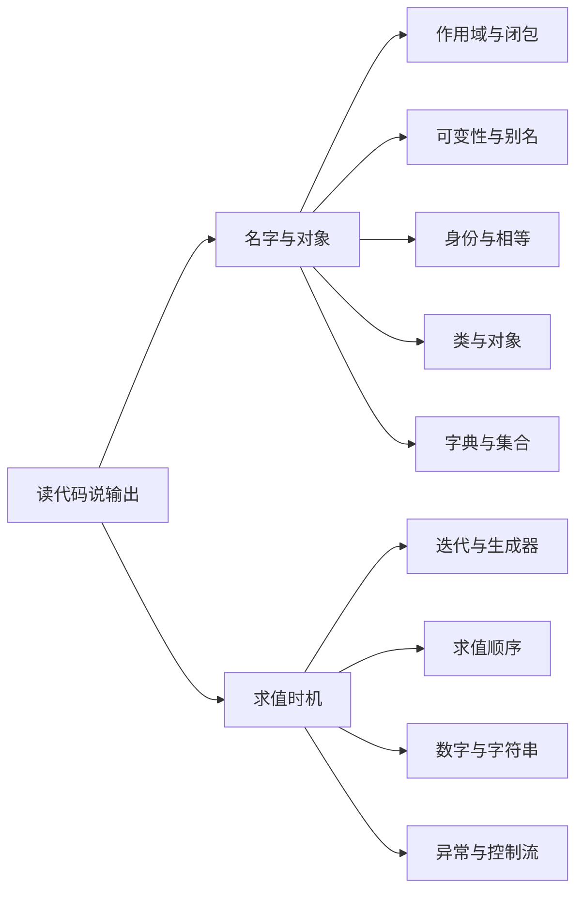

## Q
**读代码说输出：这一组题怎么读**

## A
**一句话。** Python 的怪输出几乎都来自两件事：名字只是贴在对象上的标签，以及一个表达式是在定义时还是调用时求值。

**关键直觉。**

- 赋值不复制：`b = a` 只是多贴一个标签，列表乘法、浅拷贝、默认参数、`+=` 的怪结果都是同一个对象被多个名字共享。
- 区分定义时和调用时：默认参数在 `def` 时算一次，闭包里的变量在调用时才去查，生成器最外层在创建时算、其余在消费时算。
- 作用域在编译期按赋值决定：函数里只要赋值就是局部，类体不是闭包的外层，所以 `UnboundLocalError` 和类体里推导式的 NameError 都来自这条规则。
- `==` 比值，`is` 比身份；容器先看身份再看 `==`，所以 NaN 和缓存对象会给出看似矛盾的结果。
