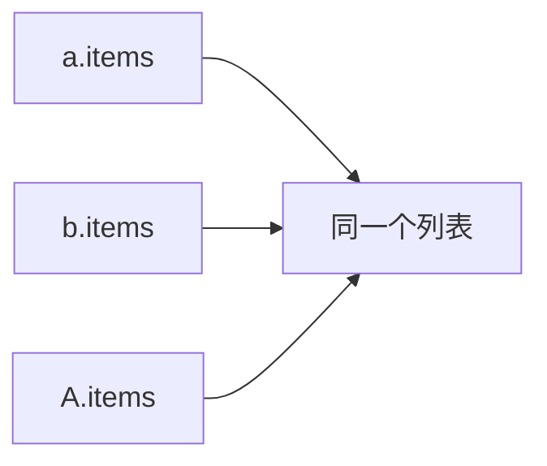

## Q
**类属性与 +=**｜读代码说输出

```python
class A:
    n = 0
    items = []
a, b = A(), A()
a.n += 1
a.items += [1]
print(a.n, b.n, A.n)
print(b.items, A.items is a.items)
print(a.__dict__)
```

输出什么？

## A
**输出。**
```
1 0 0
[1] True
{'n': 1, 'items': [1]}
```

**为什么。**
- 读 `a.n` 时先查实例，没有再查类。`a.n += 1` 等于 `a.n = a.n + 1`：读到类上的 0，加 1 后**赋值给实例**，于是 a 有了自己的 `n`，类和 b 不受影响。
- `a.items += [1]` 先对共享的列表原地 `extend`（`__iadd__`），再把同一个列表赋给 `a.items`，所以 a 的 `__dict__` 里多了 `items`，但它仍是类上那一个列表，b 也看到 [1]。



**语言为什么这样设计。**
- 属性赋值永远写在对象自己的 `__dict__` 里，查找才沿类链上溯；这条规则简单，也让类属性可以当默认值用。
- 不可变值（int）的 `+=` 退化成赋值，可变值（list）的 `+=` 原地修改；Java 的 `static` 字段则只有一份，实例上不能“遮住”它。

**怎么写才对。**
```python
def __init__(self): self.items = []   # 可变状态放在 __init__ 里
```

**面试里一句话。**
Assignment always binds on the instance while lookup falls back to the class, so a mutable class attribute is shared by every instance.
