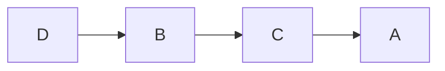

## Q
**菱形继承里的 super**｜读代码说输出

```python
class A:
    def f(self): print("A")
class B(A):
    def f(self): print("B"); super().f()
class C(A):
    def f(self): print("C"); super().f()
class D(B, C):
    def f(self): print("D"); super().f()
D().f()
print([k.__name__ for k in D.__mro__])
```

输出什么？

## A
**输出。**
```
D
B
C
A
['D', 'B', 'C', 'A', 'object']
```

**为什么。**
- `super()` 不是“父类”，而是“方法解析顺序（MRO）里排在当前类后面的那个类”。
- D 的 MRO 由 C3 线性化算出：子类在父类前，且保持 `(B, C)` 的书写顺序，所以是 D、B、C、A。
- B 里的 `super().f()` 走到 C 而不是 A：它看的是 `type(self)` 的 MRO，A 因此只被调用一次。



**语言为什么这样设计。**
- 多继承下 `super()` 链式协作，保证每个基类方法只执行一次，菱形顶端不会被重复初始化；C3 还保证顺序前后一致、可预测。
- Java 只允许单继承类加接口，把菱形问题挡在外面；C++ 的菱形要用虚继承，由最派生类负责构造顶端基类。

**怎么写才对。**
```python
# 协作式继承：每一层都调用 super().f()，并接收 **kwargs 往后传
```

**面试里一句话。**
`super()` follows the MRO of the instance's class, not the textual parent, which is how diamonds call each base exactly once.
