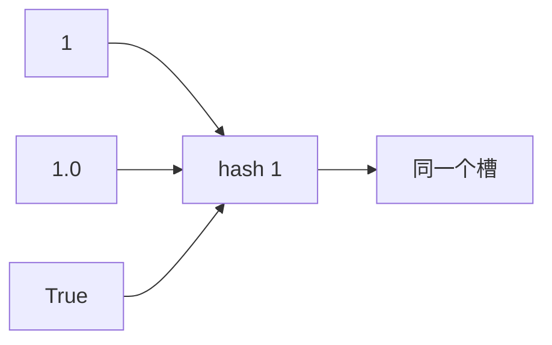

## Q
**相等的键互相覆盖**｜读代码说输出

```python
d = {1: "int", 1.0: "float", True: "bool"}
print(d, len(d))
d2 = {True: "a", 1: "b"}
print(d2)
print({0: 1, False: 2, 0.0: 3})
```

输出什么？

## A
**输出。**
```
{1: 'bool'} 1
{True: 'b'}
{0: 3}
```

**为什么。**
- 字典先比哈希，哈希相同再比 `==`。`hash(1) == hash(1.0) == hash(True)`，且三者 `==` 为真，所以是同一个键。
- 值被后来者覆盖，但**键对象保留最先插入的那个**：`{True: "a", 1: "b"}` 的键仍显示为 `True`，值是 "b"。
- 0、0.0、False 同理，只剩第一个键 0，值是最后的 3。



**语言为什么这样设计。**
- 数值的哈希与相等必须跨类型一致，这样 `1 == 1.0` 与 `{1.0} == {1}` 才自洽；`bool` 本身是 `int` 的子类。
- Java 的 `Integer(1)` 与 `Double(1.0)` 不 `equals`，是两个键；JavaScript 对象键一律转成字符串，`1` 与 `"1"` 反而相同。

**怎么写才对。**
```python
# 键里别混用 1/True/1.0；需要区分类型时用 (type(k), k) 作键
```

**面试里一句话。**
Dict keys are matched by hash then equality, and `1`, `1.0` and `True` hash and compare equal, so they collapse into one key.
