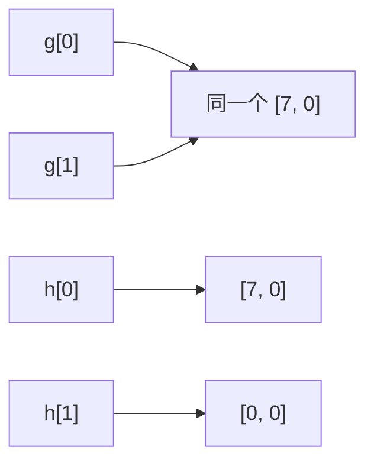

## Q
**列表乘法**｜读代码说输出

```python
g = [[0] * 2] * 2
g[0][0] = 7
print(g)
h = [[0] * 2 for _ in range(2)]
h[0][0] = 7
print(h)
print(g[0] is g[1], h[0] is h[1])
```

输出什么？

## A
**输出。**

```
[[7, 0], [7, 0]]
[[7, 0], [0, 0]]
True False
```

**为什么。**

- `[[0] * 2] * 2` 先造出一个内层列表，再把对它的引用重复两次：`g[0]` 和 `g[1]` 是同一个对象，改一处两处都变。
- 推导式每轮循环都重新求值 `[0] * 2`，造出两个独立的列表。
- 最后一行用 `is` 直接验证了身份（是不是同一个对象）。



**语言为什么这样设计。**

- 序列的 `*` 对任何元素类型通用，只复制引用而不复制对象：它不知道元素能不能拷贝、怎么拷贝，浅拷贝（shallow copy）是唯一安全的通用做法。
- JavaScript 的 `Array(2).fill([])` 是同一个坑；NumPy 的 `np.zeros((2, 2))` 直接分配独立内存，没有这个问题。

**怎么写才对。**

```python
h = [[0] * 2 for _ in range(2)]   # 二维表永远用推导式
```

**面试里一句话。**

Sequence repetition copies references, not objects, so multiplying a list of lists gives rows that are all the same list.
