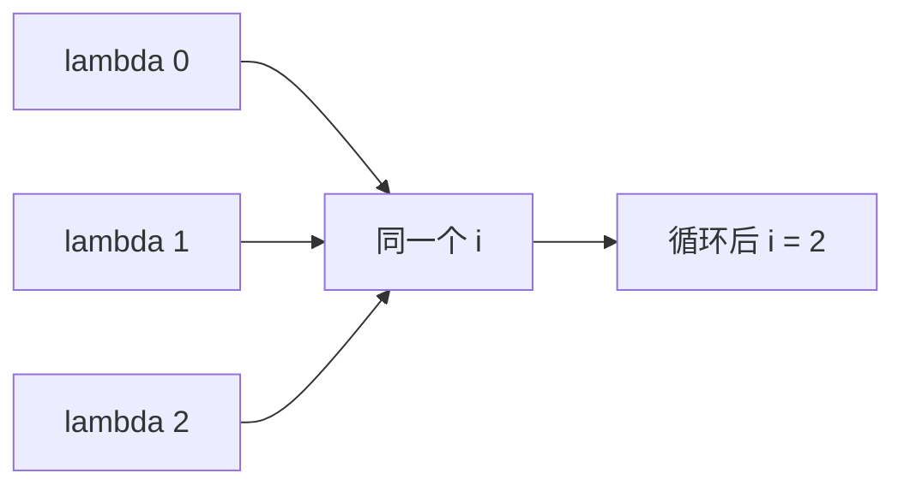

## Q
**循环里的 lambda**｜读代码说输出

```python
fs = [lambda: i for i in range(3)]
print([f() for f in fs])
fs = [lambda i=i: i for i in range(3)]
print([f() for f in fs])
```

输出什么？

## A
**输出。**

```
[2, 2, 2]
[0, 1, 2]
```

**为什么。**

- lambda 体里的 `i` 不是在定义时取值的，而是在调用时去外层作用域查找；三个 lambda 捕获的是同一个变量 `i`（同一个 cell）。
- 循环结束时 `i` 停在 2，所以三次调用都读到 2。
- 默认参数 `i=i` 在 lambda 创建那一刻求值，每个函数对象各存一份当时的值，于是得到 0、1、2。



**语言为什么这样设计。**

- 闭包（closure）捕获的是变量本身而不是值，这样 `nonlocal` 才能让内层函数改写外层变量；代价就是晚绑定（late binding）。
- JavaScript 的 `let` 每轮循环新建一个绑定，Go 1.22 起每轮也是新变量，所以它们得到 0、1、2；Java 的 lambda 只能捕获 effectively final 的变量，这种写法根本编译不过。

**怎么写才对。**

```python
fs = [lambda i=i: i for i in range(3)]
# 或者 functools.partial(func, i)
```

**面试里一句话。**

Python closures capture variables, not values, so every lambda in the loop sees the final value of i unless you bind it as a default argument.
