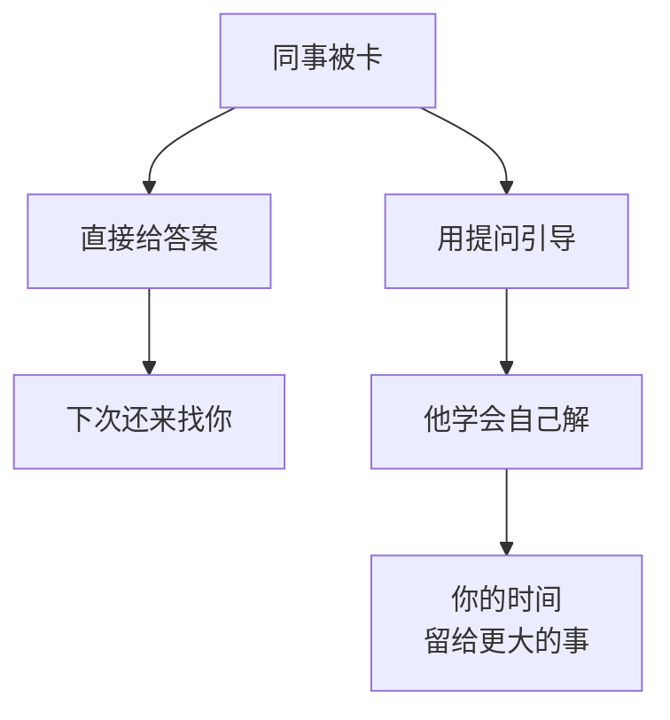

## Q
**Being the strongest · 别做瓶颈**｜原则 · 加分

你是团队里最强的工程师，所有难题、评审、线上问题最后都来找你。你每天很忙，但团队的产出并没有随之提高，新人也长得慢。你怎么调整？

## A
**原则：** 最强的人最容易变成**瓶颈**。资深的做法是**放大别人**：让别人能自己解决，而不是你亲自全做。

**怎么做：**
1. **帮人解卡，但不直接递答案：** 看到同事卡了好几天就主动结对；就算你一眼看出是哪一行代码，也用提问带他找到，顺便教他一种新的调试方法。
2. **写下来：** 同样的问题第二次有人问，就写成笔记或加进团队 wiki，下次丢链接。
3. **外部阻塞由你出面：** 等别的团队评审、等平台改接口，这类团队内部解不了的问题，你去沟通，并讲清怎么做的，让别人学会。
4. **指导时晚一点给方案：** 多提问、给多个选项，帮对方说清取舍，而不是替他做决定。
5. **交出任务后别收回：** 对方做法和你不同，只要能达到目标就接受。

**常见错法：**
- **当英雄：** 所有难事都自己扛，团队技能不增长，你一不在就停摆。
- **替人把活干了：** 省了今天的五分钟，换来每周的重复求助。
- **看到别人做法不同就把任务拿回来：** 会让人觉得你不信任他，以后不再找你商量。

**回到题目：** 先统计一周有多少求助是同类问题，把它们写成文档；对新人用提问方式带，不直接给答案；评审时让别人先当主评审，你只补充；腾出的时间做方向性的工作。

面试官看什么 · 配哪类故事 · 出处

**面试官在考什么：** 你是否理解高级别的价值在于团队整体产出，而不是个人产出。

**适合配哪类故事：** 你把自己擅长的事教给别人、写成文档或自动化，使团队不再依赖你一人的经历。

**出处：** Orosz《The Software Engineer's Guidebook》ch11 §3 "Your Team"（"Unblock your team"、"Document for others"）；ch12 §3 "Mentoring"（"Avoid serving up answers on a silver platter"）；ch22 §1（"Distrusts other engineers"）

