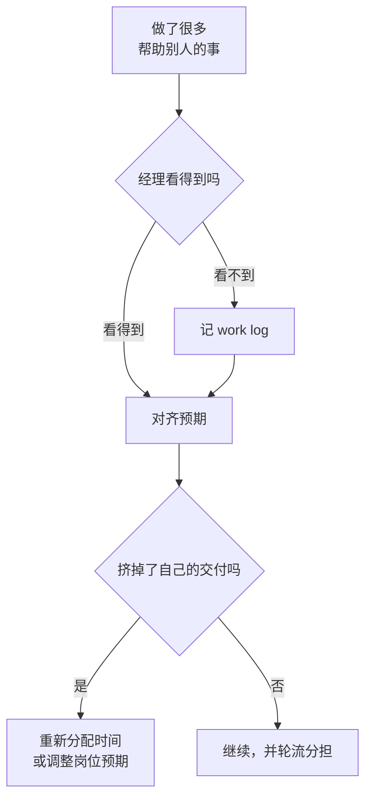

## Q
**Glue work · 看不见的协调**｜原则 · 加分

半年来你一直在做这些事：帮同事 review、搭桥让两个团队对齐、写文档让新人能上手、盯着别人被卡住的任务。到了绩效评估，经理说"你自己的项目产出偏少"。你怎么办？

## A
**原则：** 帮助团队成功的协调工作叫 **glue work**（粘合工作，Tanya Reilly 的说法）。它有价值，但很容易**不被看见**，甚至让你显得"不专注"。所以：有意识地做，把它记下来，并且别让它挤掉自己该交付的东西。

**怎么做：**
1. **何时做：** 团队有人被卡、新人上手慢、两个组各说各话时，这些事值得做。完全不做的人，会被看成自私、只顾自己的绩效。
2. **让它被看见：** 保持一份 work log，写下你帮了谁、解决了什么，至少让经理知道。
3. **何时停：** 如果大部分时间都在帮助别人，几乎没时间"把事做完"，就要重新评估时间分配，或者和经理重谈对这个岗位和级别的预期。
4. **别把它变成固定的一个人的活：** 团队可以轮流承担，或把重复的协调写成文档、流程。

**常见错法：**
- **默默做，等别人发现：** 别人通常不会注意到，反而觉得你自己的事做得少。
- **完全不做：** 同事会觉得你不是个好队友。
- **把所有协调都揽下来：** 自己的核心交付受损，也养成团队依赖。

**回到题目：** 先用 work log 把半年里的协调工作列出来，找经理对齐："这些事我认为对团队有价值，你怎么看？"同时确认你的核心交付目标，必要时一起决定哪些协调可以交给别人或自动化。

**面试官在考什么：** 你是否有团队意识，同时懂得为自己的工作争取可见度，而不是一味牺牲。

**适合配哪类故事：** 你花时间帮助团队（评审、文档、跨组协调），后来用记录和沟通让这部分贡献被认可，或重新平衡了时间的经历。

**出处：** Orosz《The Software Engineer's Guidebook》ch3 §2 "The Power of Habit"（"Help others" 与 "Capture work you do to help others"，引 Reilly《Being Glue》noidea.dog/glue）
