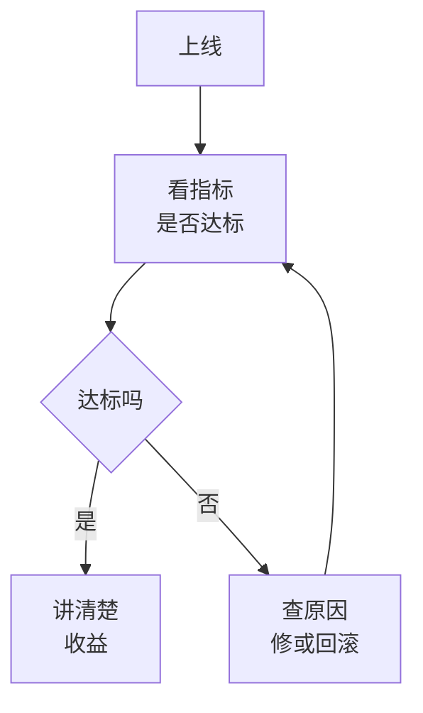

## Q
**Owning outcomes · 做完 ≠ 做成**｜原则 · 必会

你们团队上线了一个新的推荐接口，ticket 全部关闭，发布顺利。三周后你发现点击率没涨，而且接口 p99 延迟比旧版还高。经理没问过。你该做什么？

## A
**原则：** 负责到**结果**，不是负责到 ticket 关闭。工程师拿工资是为业务解决问题，写代码只是常见手段。

**怎么做：**
1. 上线前就写下要看的指标（业务指标和稳定性指标），不是上线后才想。
2. 上线后主动看，不等别人问。
3. 没达标就别只等：查原因，提出修复、调整范围、或回滚的选项，附带取舍。
4. 把结果讲出来：做了什么、遇到什么、指标怎么变，不要假设经理自己会发现。
5. 比修一个 bug 更远一步：加测试防止复发、加监控尽快发现、让修法容易维护。

**常见错法：**
- **以 ticket 关闭为终点：** "我做完了"和"问题解决了"是两回事。
- **把路障闷在手里：** 遇到阻塞不讲，自己拖到别人来救。早点讲，并带上几个取舍（砍范围、先上临时方案、找别人解决）。
- **只在做成时才沟通：** 没达标更需要沟通，而且越早越好。

**回到题目：** 先确认延迟为什么变差（例如多了一次下游调用），拿出数据；然后向经理和 PM 同步："点击率没涨、p99 变差，我的判断是……，建议先……"。不要等别人发现。

**面试官在考什么：** 你的责任边界在哪里：做完、上线，还是业务结果。资深的信号是"看指标，主动闭环"。

**适合配哪类故事：** 你上线后发现结果没达预期，主动跟进、修复或回滚，并把结果讲清楚的经历。

**出处：** Orosz《The Software Engineer's Guidebook》ch11 §1 "Getting Things Done: Perception and Reality"（"Communicate roadblocks early and offer tradeoffs"）；ch11 §4 "The Big Picture"；Part III 引言 "Software development vs software engineering"
