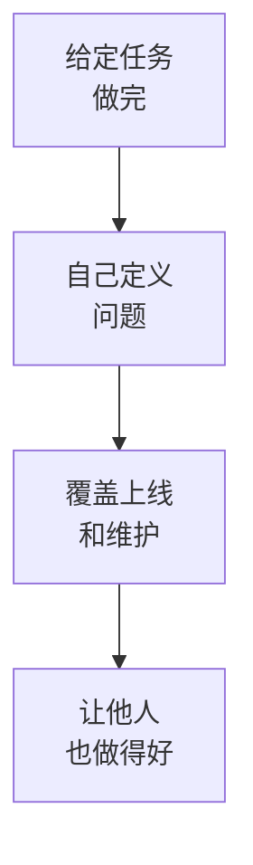

## Q
**Scope, Autonomy, Impact · 资深看什么**｜原则 · 必会

一个 Mid 级（有几年经验、能稳定交付分到手的任务）的后端工程师对你说："我 ticket 做得比 senior 还快，为什么还不是 senior？"你怎么回答？

## A
**原则：** Senior 和 Mid 的差别不在写代码的速度，而在**能独立处理多大、多模糊的问题，以及影响有多远**。可以拆成三个维度：

| 维度 | Mid | Senior |
|---|---|---|
| Scope（工作范围） | 做分到手、定义清楚的任务 | 自己把需求、方案、上线、维护整条线想清楚 |
| Autonomy（独立度） | 需要有人拆任务、给方向 | 复杂问题自己搞定，不需要手把手 |
| Impact（影响） | 影响自己这块代码 | 影响整个系统、团队，看长期（bug 会不会再来、能不能被发现、好不好维护） |

**怎么做：**
1. 拿到任务先问"真正要解决的问题是什么"，不只是"怎么实现"。
2. 修完 bug 再往前一步：加测试防复发、加监控尽快发现、让修法容易维护。
3. 把工作讲清楚：难在哪、花了多少、结果如何，别假设经理看得见。
4. 查清楚本公司的 ladder（职级表）：看全梯子、看岗位的业务影响和 blast radius（直接受你决定影响的工程师人数），同一个 senior 在不同公司要求不同。

**常见错法：**
- **只比速度：** 快是 Mid 的优势，Senior 要的是"挑对要做的事"。
- **照搬别家的 senior 标准：** 同样叫 senior，有的公司两次晋升就到，有的要四次；有的公司 senior 是终点级别（terminal level），要求自己搞定复杂项目，但不要求继续往上。
- **只拉大范围不拉深度：** 到处插手却没有一件做完并能看到结果。

**回到题目：** 速度是 Mid 的合格线。把他最近一个 ticket 拿出来问：需求是谁定义的？修完以后同类问题还会不会再发生？别人能不能接手维护？答不上的部分，就是他和 senior 之间的距离。

**面试官在考什么：** 你对 senior 的理解是不是"做更大、更模糊的事并为长期后果负责"，而不是"更快的 Mid"。

**适合配哪类故事：** 你从做一个任务，扩展到定义问题、补上测试和监控、让别人能接手的经历；或者你帮别人把工作变得更清楚、更有影响的经历。

**出处：** Orosz《The Software Engineer's Guidebook》Part III 引言 "Software development vs software engineering"、"Typical senior engineer expectations"、"Senior as a terminal level"；Part V 引言 "Why do titles vary so much between companies?"（blast radius）
