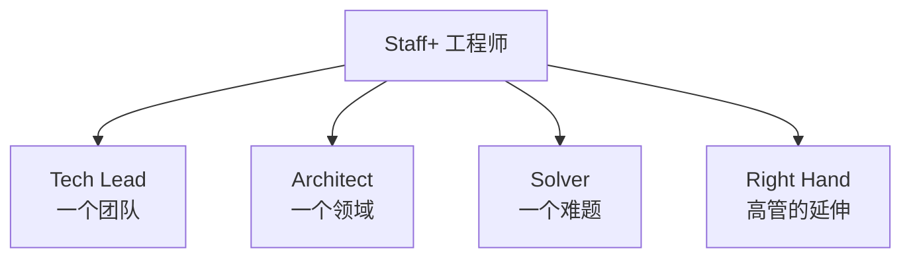

## Q
**Staff archetypes · 你是哪一类 Staff**｜原则 · 加分

面试官问："你想往 Staff+ 走。同样是 Staff，有的人带一个团队做项目，有的人几乎不写代码只画架构图。你觉得自己更像哪一类？这会怎么影响你和别的 Staff 合作？"

## A
**原则：** Staff+ 不是一个岗位，是几种**工作方式**。Will Larson 把它们分成四类（archetype，原型）。先认清自己和同伴各是哪一类，再决定怎么分工，避免两个人抢同一件事。

| archetype | 一句话 | 典型工作 |
|---|---|---|
| Tech Lead | 带一个团队的方案和执行 | 拆项目、评审设计、盯交付 |
| Architect | 对一个关键领域的方向、质量负责 | 定技术方向、立规范、评大决策 |
| Solver | 钻进最难的问题找出路 | 被派去救火、攻关，解完换下一个 |
| Right Hand | 借用工程高管的权限和视野 | 替高管跨组织推动、处理复杂局面 |

**怎么做：**
1. **自评：** 看你最近半年的时间花在哪：带项目、定方向、攻难题，还是替上级处理跨组织的事。
2. **了解同伴：** 一个团队里常有多个 Staff；和 Tech Lead 合作，是配合他的项目节奏；和 Architect 或 Right Hand 合作，是对齐方向和上级的意图。
3. **行为会变：** 这些描述的是行为，不是身份。同一个人这个项目更动手，下个项目更偏方向。
4. **别把"架构师"做成脱离代码：** Orosz 的观察是，常和代码打交道的架构师决策更好；脱离一线、"自上而下"发号施令的 ivory tower architect 往往不知道工程师有什么异议。

**常见错法：**
- **把某一类当成唯一正解：** 觉得只有 Architect 才是 Staff，或只有写代码才有价值。
- **两个 Staff 同时当 Tech Lead：** 团队听到两套指令。
- **不动手也不在值班轮里：** 被同事视为远离一线、做决定不负责的人。

**面试官在考什么：** 你对高级别角色的理解是否具体，是否知道自己的偏好和短板，并能说清怎样和不同类型的 Staff 协作。

**适合配哪类故事：** 你在不同阶段扮演过不同角色（带项目、攻难题、定方向），并因此调整了和同级工程师分工的经历。

**出处：** Orosz《The Software Engineer's Guidebook》ch22 §4 "Collaborating with Staff+ Peers"（"Be aware that collaborating with staff+ archetypes is different"，引 Larson，staffeng.com/guides/staff-archetypes）；ch25 §9 "Software Architect Traits"
