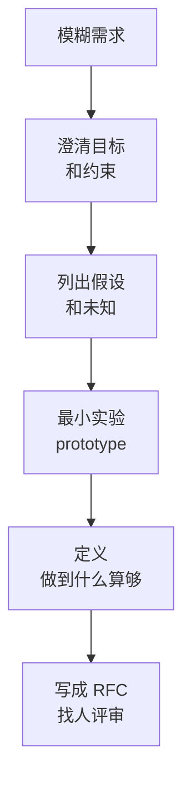

## Q
**Taming ambiguity · 模糊需求怎么落地**｜原则 · 必会

产品经理跟你说："我们要接入一家新的第三方支付渠道，下个季度要上，具体怎么接你来定。"文档没有、接口没读过、需求只有一句话。你周一接到，周五要给团队一个方向。你怎么做？

## A
**原则：** 模糊的问题靠**把未知变成已知**来驯服：先问清目标，再用最小的实验验证最大的不确定，最后写下"做到什么算够"。

**怎么做：**
1. **澄清：** 跟 PM 和相关团队确认"为什么做、给谁用、不做会怎样"。kickoff 的作用就是把"why / what"对齐，越早问越便宜。
2. **列假设和未知：** 例如"这家渠道有沙箱""回调是幂等的""对账文件每天一份"，哪些没确认，就是风险。
3. **做最小实验：** 对不确定的部分写一个 throwaway prototype（用完就丢的原型），例如先调通渠道的下单接口。目的是证明能行，不是写生产代码。
4. **定"做到什么算够"：** 写下范围（第一版只做哪几种支付方式）和成功标准，让别人能对照检查。
5. 周五给出的是方向、风险、下一步，不是完整设计。

**常见错法：**
- **等需求变清楚再动：** 模糊不会自己消失，你要主动去消除它。
- **一上来就写生产代码：** 做到一半才发现对方接口不支持，前面全部返工。
- **原型被当成成品：** 上级看了演示说"可以上了"。要坚持重写；必要时刻意用不上线的技术栈写原型。
- **没写"做到什么算够"：** 范围无限膨胀，没人知道什么时候算完成。

**回到题目：** 周一和周二：和 PM、支付团队、风控团队各谈一次，写出假设清单。周三到周四：对最不确定的一两件事（下单、回调）写原型。周五：给出方向、已验证和未验证的点、第一版范围。

**面试官在考什么：** 你面对模糊时是不是主动推进，用实验和文字把问题变小，而不是等人来拆任务。

**适合配哪类故事：** 你拿到一个只有一句话的需求，用原型或调研把它变成清晰的方案和范围的经历。

**出处：** Orosz《The Software Engineer's Guidebook》ch15 §2 "Prototyping and Proof of Concept"（含 "Build with the intent to throw it away"）；ch16 §3 "Project Kickoffs and Milestones"
