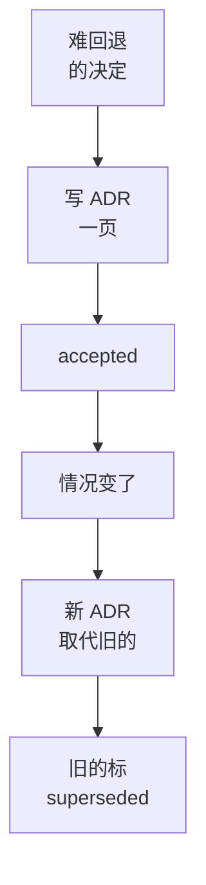

## Q
**ADR · 记下难回退的决定**｜原则 · 必会

新同事问："为什么我们的订单服务用 PostgreSQL 的 JSONB 而不是单独的文档数据库？这代码看起来很别扭。"没人记得当时的原因。你怎么避免以后再有这种问题，又不让团队被文档淹没？

## A
**原则：** ADR（architecture decision record，架构决策记录）是**一页**纸，记一个决定的背景、结果、后果；用来保存"当时为什么这样选"。放在代码仓库里，用 Markdown。

**怎么做：**
1. 结构（MADR 模板）：标题、Context and Problem Statement、Considered Options、Decision Outcome（选了谁、为什么）、Consequences（好处和代价）。
2. 状态写在头部：proposed、accepted、rejected、deprecated、superseded by ADR-xxxx。
3. **只记难以回退的决定：** 小决定不用记，否则没人看。
4. **不改历史：** 决定变了，写新 ADR 取代旧的，旧的保留并标注被谁取代，这样看得到演变过程。
5. 与 design doc 的区别：design doc 是征求意见、会被评论和修改的；ADR 是记录已做的决定，不为征求意见。

**常见错法：**
- **每个决定都写：** 一堆没人读的文件。
- **事后改旧 ADR：** 历史被抹掉，后人不知道当时的真实情况。
- **只写决定不写代价：** 没有 Consequences，后人看不到你知道哪些风险。

**回到题目：** 回头为这件事补一份 ADR：背景（半结构化数据、团队不想多运维一套系统）、选项（JSONB、文档数据库）、决定与理由，以及后果（查询要自己建索引、将来数据量大要重新评估）。以后凡是难回退的存储或协议决定，都补 ADR。

面试官看什么 · 配哪类故事 · 出处

**面试官在考什么：** 你是否有保存决策背景的习惯，并懂得"只记重要的、不改历史"。

**适合配哪类故事：** 你留下一份决策记录，让之后的人少走弯路，或者帮团队解释了一个"奇怪但有理由"的设计的经历。

**出处：** Orosz《The Software Engineer's Guidebook》ch15 §1 "Architecture documents"（ADR、C4、Arc42）；adr.github.io；MADR 模板（github.com/adr/madr，template/adr-template.md）

