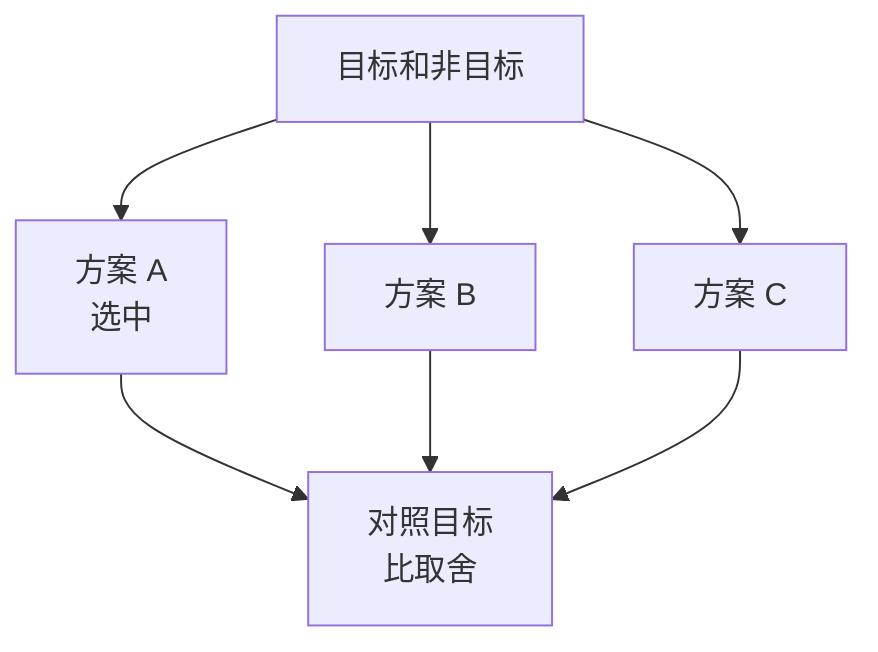

## Q
**Alternatives considered · 为什么没选别的**｜原则 · 必会

你的 design doc 提议用 Kafka 做订单事件分发。评审时一位同事说："为什么不直接用数据库里的 outbox 表轮询？"你的文档里完全没提这个方案。接下来该怎么补救，以后怎么避免？

## A
**原则：** "替代方案"一节要列出**确实能达到类似结果**的其他设计，并说明各自的取舍，以及这些取舍怎样让你选了现在这个。它是文档里最重要的部分之一：读者心里想问的"那为什么不……"，在这里被回答。

**怎么做：**
1. 至少写一个**认真的**替代方案：能达到目标的，不是为了凸显主方案而摆的稻草人。
2. 每个方案讲取舍：它好在哪、差在哪，对照目标和非目标判断。
3. 可以写得简短，但要让读者看见：你想过，为什么现在这个更适合**这个项目的目标**。
4. 评审中提出的新方案，补进这一节。
5. 这一节还会成为日后别人理解"当时为什么这么选"的记录。

**常见错法：**
- **稻草人：** 列三个明显更差的方案，读者一眼看穿，反而失去信任。
- **只写优点：** 没有取舍的方案不可信。
- **不写：** 评审里被问到时才第一次想，说明设计之前没想清楚。

**回到题目：** 现场如实回答：outbox 的好处是……，代价是……，对照我们的目标（吞吐、多消费者、重放）选了 Kafka。会后把 outbox 方案补进文档的"替代方案"，附上取舍和决定理由，以后同样的问题直接看文档。

**面试官在考什么：** 你的决定是不是经过比较，你能不能把取舍说清；资深的信号是主动把对立方案摆出来。

**适合配哪类故事：** 你通过比较方案，发现主方案不是最合适的，或者在评审中用替代方案的比较说服了别人的经历。

**出处：** Malte Ubl《Design Docs at Google》（industrialempathy.com）"Alternatives considered"；Orosz《The Software Engineer's Guidebook》ch15 §1
