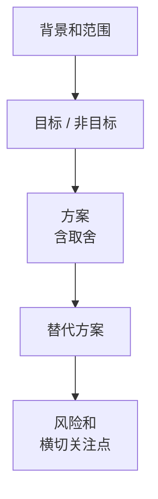

## Q
**Design doc · 写代码前先写文档**｜原则 · 必会

你要给订单服务加"部分退款"，会碰到支付、库存、对账三个团队的代码，预计做六周。同事说："直接开工吧，写文档浪费时间。"你怎么说服他，文档里写什么？

## A
**原则：** design doc（写代码前给团队看的设计文档）的目的，是在改动还便宜的时候**发现错误、拿到反馈、让想法能被别人读懂**。它是减少整个项目耗时的工具，不是仪式。

**怎么做：**
1. **背景和范围：** 简短、只讲客观事实；不是需求文档。
2. **目标 / 非目标：** 几条要点（下一张卡细讲）。
3. **方案：** 先总览再细节；重点写做过的**取舍**；API 和 schema 只写与取舍有关的部分，不整段贴。
4. **替代方案：** 为什么没选别的。
5. **风险和横切关注点：** 安全、隐私、可观测性这类每个设计都要想的事。
6. 篇幅：大项目 10–20 页左右；小改动写 1–3 页的 mini design doc，步骤相同，只是更精炼。
7. 发出去让人评论：异步评论、开会、或两者结合，看影响多少团队。

**常见错法：**
- **写成实现手册：** 只讲"我们怎么实现"，没有取舍和替代方案，等于没写。
- **写完才开评审：** 做完再补文档，大家当成走流程，没人愿意提实质意见。
- **太长没人读：** 超过合理篇幅就拆成子问题。
- **只给自己看：** 不写下来，五个人想了解就要找你五次。

**回到题目：** 对同事说："文档的目的是在改动还便宜时找错。部分退款会碰到三个团队，现在让他们看一遍，比开发到第四周才发现对账不支持便宜得多。"文档按上面五段写，1–2 周内收完评论再放手开工，或者边评审边做低风险部分。

**面试官在考什么：** 你把文档当成降低风险、对齐团队的工具，而不是官僚负担；也知道结构和篇幅的取舍。

**适合配哪类故事：** 你靠一份设计文档在评审中拦下了一个设计错误，或者让多个团队在开工前就对齐的经历。

**出处：** Orosz《The Software Engineer's Guidebook》ch15 §1 "Design Documents, RFCs and Architecture Documents"（The goal of an RFC、Benefits、Reviewing RFCs）；Malte Ubl《Design Docs at Google》（industrialempathy.com，Anatomy of a design doc、The length of a design doc）
