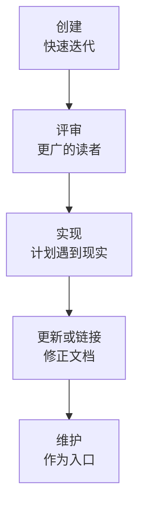

## Q
**Doc review & lifecycle · 评审与维护**｜原则 · 加分

你的 design doc 发出去两周，只有一条评论；三个月后项目上线，文档里的架构图和实现已经对不上。怎么让评审有效、让文档不变成过期的废纸？

## A
**原则：** design doc 有**生命周期**：创建与迭代、评审、实现中更新、维护。评审的目的是**在改动还便宜时**，让组织的经验塑造设计，而不是走流程。

**怎么做：**
1. **选评审方式：** 异步（文档里评论）、同步（开会深聊）、混合（先异步，评论多或项目复杂再开会）。影响二十个团队和只影响你加一个伙伴团队，做法不同。
2. **以"省总时间"为准：** RFC 的真正目的是靠早反馈缩短交付时间。等一个资深评审会议拖住进度时，可以直接找关键人要反馈。
3. **点名评审人：** 谁受影响就让谁读（上下游团队、安全、数据），别指望一个中央邮件列表有人看。
4. **何时关闭：** 重大修改不太可能再出现，就可以开工；评审要有明确结论和状态。
5. **实现中更新：** 计划碰到现实后要回来改文档，尤其是还没上线时；若改动写在新文档里，要从原文档链接过去。
6. **维护：** 文档会逐渐和系统脱节，但仍是理解系统的入口；写清日期和状态，过期的标出来，或归档。

**常见错法：**
- **只发一次、不点名：** 没有评论就当作同意。
- **评审变成开会走过场：** 拖慢进度，也没人真看。
- **上线后不回头：** 文档和系统两张皮，新人被误导。

**回到题目：** 点名上下游团队和一位资深评审，约定一个截止日；一周内没反馈就当面问；上线后在文档顶部写明"与实现的差异"并链接新文档，必要时标为 superseded（被取代）。

面试官看什么 · 配哪类故事 · 出处

**面试官在考什么：** 你是否把文档当作活的协作工具，会推动评审，也会维护。

**适合配哪类故事：** 你推动一份设计文档拿到关键反馈、改变了方案，或把过期文档整理成团队入口的经历。

**出处：** Ubl《Design Docs at Google》"The design doc lifecycle"（Review、Implementation and iteration、Maintenance and learning）；Orosz《The Software Engineer's Guidebook》ch15 §1 "Reviewing RFCs"；ch13 §4 "Documentation"

