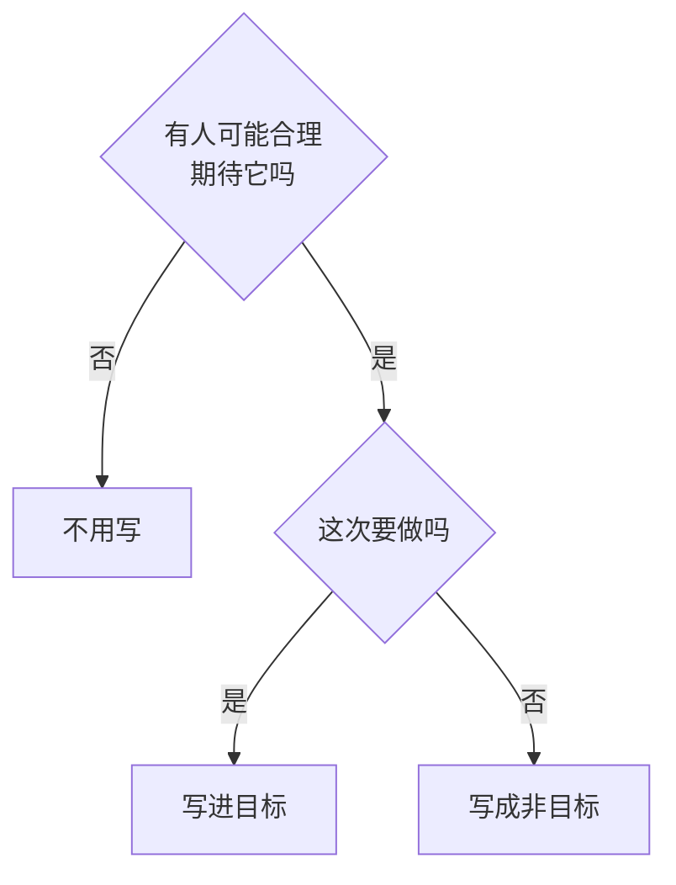

## Q
**Goals & non-goals · 非目标怎么写**｜原则 · 必会

你在评审一份"自建任务调度系统"的 design doc。非目标一栏写着："系统不应该崩溃""不追求性能差"。你该怎么指出问题，并给出改法？

## A
**原则：** 非目标（non-goal）不是目标的否定句，而是**别人可能合理地期待，但我们明确选择不做**的事。它划出范围，让评审的人知道不用再提这些要求。

| 写法 | 判断 |
|---|---|
| "系统不应该崩溃" | 否定了一个目标，不是非目标 |
| "不支持跨地域强一致" | 合理的期待，明确不做，是非目标 |
| "不提供可视化界面（第一版只给 API）" | 合理的期待，明确不做，是非目标 |

**怎么做：**
1. 先列目标：几条要点，说清要解决什么。
2. 再问："读者可能会期待哪些没有写在目标里的东西？"这些逐条判断，不做的写成非目标。
3. 非目标往往比目标更重要：它让评审集中在你选的范围上。
4. 非目标不代表拒绝带来这个性质的方案：如果某个方案恰好也提供了，而且没有伤到目标，仍然可以选。

**常见错法：**
- **把否定的目标当非目标：** "不要慢""不要出错"，没人会期待这些，它们根本不算范围。
- **只写目标不写非目标：** 评审的人按各自想象提要求，范围越评越大。
- **非目标写得太宽：** 什么都不做，读者看不出系统到底做什么。

**回到题目：** 指出这两条是被否定的目标，没有给出范围。让作者改成这样："不支持任务之间的跨地域强一致""不提供图形化管理界面，第一版只有 API""不做优先级抢占"。

**面试官在考什么：** 你有没有范围意识：知道一份设计要说清"不做什么"，评审才有焦点。

**适合配哪类故事：** 你通过明确写出"不做什么"，避免了需求膨胀或拦下了一场无谓争论的经历。

**出处：** Malte Ubl《Design Docs at Google》（industrialempathy.com）"Goals and non-goals"
