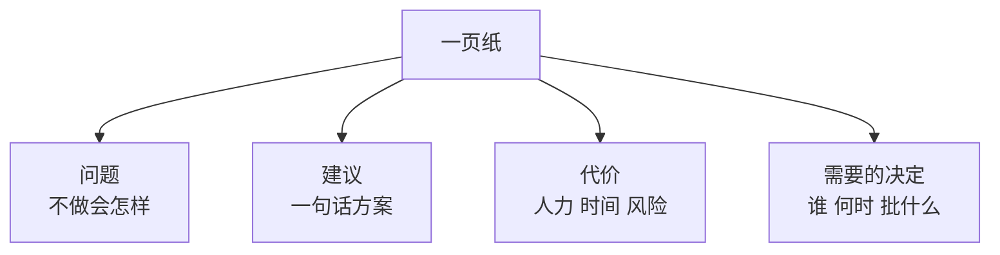

## Q
**One-pager for leadership · 给管理层的一页纸**｜原则 · 加分

你想让总监批准一个为期一个季度的数据库迁移。你手上有十页 design doc，但总监只有五分钟。你交给他什么？

## A
**原则：** 管理层要的是**做决定所需的信息**，不是技术过程。一页纸回答四件事：**问题、建议、代价、需要的决定**。

**怎么做：**
1. **结论放最前：** 第一行就写"请批准 X，需要 Y 人 Z 周"。
2. **问题用业务语言：** 例如"每次大促前都要手动扩容，去年有两次因此降级"（用你自己的真实情况），而不是"连接池参数不合理"。
3. **代价与风险写实：** 时间、人力、机会成本，以及最大的风险和你的缓解办法。
4. **写明需要的决定和期限：** "请在周五前确认，否则 Q3 的上线日期会推迟。"
5. **细节放链接：** 十页 design doc 作为附件，需要时再看。
6. **同样的原则适用于 status update：** 风险与请求放最前，用同一个格式持续更新，让读者把它当作"事实来源"。

**常见错法：**
- **把 design doc 贴过去：** 读者找不到自己要做什么决定。
- **只讲好处：** 没有代价，管理层反而不信任。
- **没有请求：** 读完不知道该做什么。

**回到题目：** 一页：为什么现在要迁（风险和业务影响）、建议（分阶段迁移，影子对比后灰度）、代价（几个人几周，期间新功能减慢）、需要的决定（批准资源，本周内）。附上 design doc 链接。

面试官看什么 · 配哪类故事 · 出处

**面试官在考什么：** 你能否向非技术或时间有限的人，用他们的语言争取资源。

**适合配哪类故事：** 你用一页简洁的文档争取到了一个技术项目的批准或资源的经历。

**出处：** Orosz《The Software Engineer's Guidebook》ch18 §4 "Keep Them in the Loop"（定期更新邮件包含进度、风险与缓解、时间线变化；作为 source of truth）；ch16 §5。四要素结构是对这一原则的通用整理，该书没有单独的 "one-pager" 模板。

