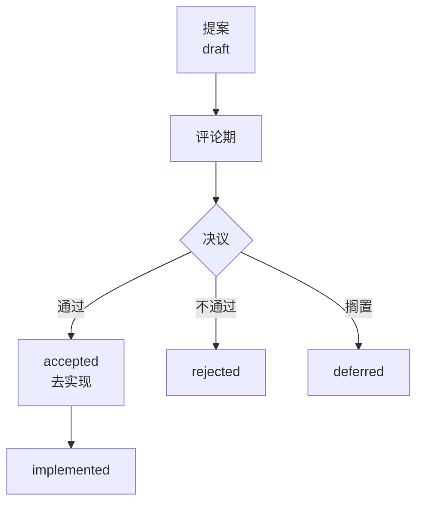

## Q
**RFC process · 提案到决议**｜原则 · 必会

你们团队要引入一套新的内部 API 规范，会影响约二十个团队。有人提议"发个邮件通知大家就行"。你想用 RFC 流程。一份有结构的 RFC 流程长什么样？

## A
**原则：** RFC（request for comments，征求意见的提案）流程的骨架是：**提案 → 评论期 → 决议 → 状态记录**。大型开源项目的流程都是这个形状，只是细节不同；目的是让影响很多人的决定有公开的讨论和清楚的结果。

| 项目 | 状态怎么记 |
|---|---|
| Python PEP | Draft、Accepted、Rejected、Withdrawn、Deferred、Final（实现完成）、Provisional（有条件接受）等，由 Steering Council 等人最终决议 |
| Rust RFC | 评论后由对应 subteam 提出 final comment period，并给出决议：merge、close 或 postpone |
| Kubernetes KEP | provisional、implementable、implemented、deferred、rejected、withdrawn、replaced |

**怎么做：**
1. 写清提案：动机、方案、替代方案、没解决的问题。
2. 定评论期和谁有决定权；影响二十个团队，就用异步评论，必要时再开会（hybrid）。
3. 决议要有明确的结果和日期，并写进状态。
4. 决议之后继续更新状态：实现了没有、被取代没有。
5. 想清楚 RFC 与开发的先后：未知多的先做 prototype 再写 RFC；依赖多的先收反馈再做；简单的可以边发边做。

**常见错法：**
- **没有决议：** 讨论越来越长，没人说"就这样定了"。
- **做完再补 RFC：** 变成走流程，没人愿意提实质意见，只剩存档价值。
- **所有事都走 RFC：** 小改动也要流程，团队被拖慢。

**回到题目：** 对"发邮件"的回应：影响二十个团队的规范，需要一个能收集意见、有结论的过程。写一份 RFC，设评论期（例如两周），按异步为主；到期由指定的负责人给出决议并记录状态，之后每个团队都能在同一处查到结论。

**面试官在考什么：** 你有没有设计过"让很多人参与并能收敛"的流程，而不只是写文档。

**适合配哪类故事：** 你推动一个跨团队的决定，通过提案、评论、决议收敛下来，并留下清楚记录的经历。

**出处：** Orosz《The Software Engineer's Guidebook》ch15 §1（The goal of an RFC、Reviewing RFCs）；PEP 1（peps.python.org/pep-0001/）；rust-lang/rfcs README "The RFC process"；Kubernetes KEP-0000（kubernetes/enhancements，sig-architecture/0000-kep-process）
