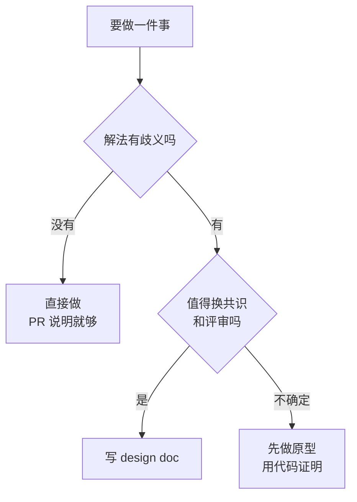

## Q
**When not to write a design doc · 写与不写的判断**｜原则 · 加分

团队新来的同事想给一个"给订单表加一个可空字段并在接口返回"的小改动写 10 页 design doc；另一边，有人要把会话存储从单机换成分布式，却说"直接做就行"。你怎么判断哪个该写？

## A
**原则：** design doc 的价值是**用低成本换共识、记录和资深人的眼睛**。方案不含歧义、没有取舍时，写它是纯开销；方案含歧义、影响大时，不写才是风险。

**怎么做：** Ubl 给了五个自问，答"是"达到三个及以上，通常值得写：
1. 我对设计不确定，需要把想法理清吗？
2. 需要资深工程师给意见吗？
3. 设计有争议吗？
4. 是否可能漏了跨领域的关注点（安全、隐私、可观测性）？
5. 需要给遗留系统一份高层说明吗？

另一个信号：写出来的文档只是**实现手册**（一步一步怎么写代码），没有取舍和替代方案，说明不必写。

**常见错法：**
- **用 design doc 当仪式：** 每件事都写，评审人疲劳，真正重要的文档被淹没。
- **该写时说"直接做"：** 没有评审，跨领域问题到上线才暴露。
- **用文档代替原型：** 有些问题写十页不如一个可运行的原型，原型也能支撑设计选择。

**回到题目：** 加字段：没有歧义，不写，PR 描述里说明即可。会话存储迁移：有取舍（一致性、延迟、运维成本）、影响多个服务、不易回退，写，必要时先做原型。

**面试官在考什么：** 你有没有判断力，而不是机械地"文档越多越好"或"文档是浪费"。

**适合配哪类故事：** 你在一件有歧义、影响大的事上坚持写了设计文档并避免了返工；或在一件小事上果断跳过文档的经历。

**出处：** Ubl《Design Docs at Google》（industrialempathy.com/posts/design-docs-at-google/）"When not to write a design doc"、"Lifecycle"；Orosz《The Software Engineer's Guidebook》ch15 §1
