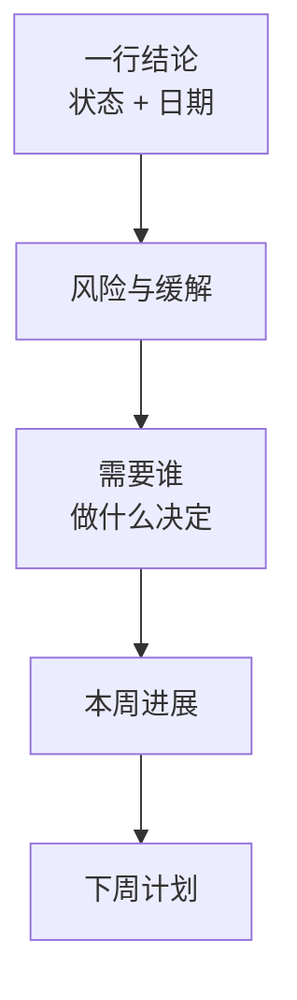

## Q
**Status updates · 结论先行**｜原则 · 必会

你负责一个跨三个团队的迁移项目，每周给十几位干系人发进度邮件。你上周写了六段详细经过，最后一行才说"可能要延期一周"。结果没人回你，延期到了才有人跳出来问。怎么改写？

## A
**原则：** 干系人（stakeholder，关心项目结果的人）读邮件的时间很少。要**让他们不被意外打到**：结论先行，风险和需要他们做的事放最前，细节放后面。

| 状态 | 含义 |
|---|---|
| 绿 | 按计划，没有需要别人介入的风险 |
| 黄 | 有风险，可能影响日期或范围，已有缓解办法；请关注 |
| 红 | 已经偏离，需要决定或资源才能回到轨道 |

（团队要先约定好每个颜色的含义，颜色才有信息。）

**怎么做：**
1. 第一行：状态、对日期的信心。例如"黄：下一个里程碑可能延后一周，原因是对方接口延迟"。
2. 风险和缓解放第二位；需要别人决定或帮助的，点名写出请求。
3. 然后才是进展和下周计划。
4. 固定节奏、固定格式；这封邮件成为"唯一的事实来源"，大家就不需要到处问你。
5. 对重要决定，需要讨论的才开会，其他保持异步。
6. 路障越早讲越好，并带上取舍：砍范围、先用临时方案、请别人解决。

**常见错法：**
- **按时间顺序写流水账：** 重点淹没在最后。
- **颜色没有约定：** 有人把"有点担心"标绿，有人把"一切正常"标黄。
- **只汇报好消息：** 最后一刻才暴露延期，信任一次用光。
- **只发给上级：** 其他干系人被漏掉，会觉得被忽略而来质疑。

**回到题目：** 改成："状态：黄。下个里程碑可能延后一周，原因：B 团队接口交付晚两天。缓解：我们先用 mock 联调。请 B 团队负责人本周三前确认交付日期。"后面再放进展和下周计划。

面试官看什么 · 配哪类故事 · 出处

**面试官在考什么：** 你能否让干系人没有意外，会不会把风险和请求放在最前面。

**适合配哪类故事：** 你及早暴露一个风险，让上级或其他团队有时间决定，避免了延期失控的经历。

**出处：** Orosz《The Software Engineer's Guidebook》ch18 §4 "Keep Them in the Loop"；ch16 §5 "Day-to-Day Project Management"（weekly status email、Keep the team accountable）；ch11 §1（Communicate roadblocks early and offer tradeoffs）

