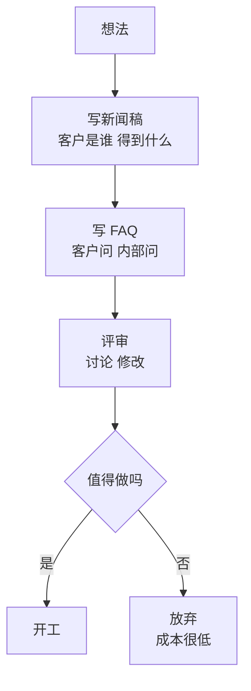

## Q
**Working backwards · 先写新闻稿**｜原则 · 加分

团队想做一个"让商家一键开通分期付款"的新功能。工程师已经在讨论用什么框架。你建议先别写代码，先写一份"假装已经发布"的新闻稿。为什么，具体怎么写？

## A
**原则：** **Working backwards（从客户倒推）**：先写出产品发布时客户会读到的新闻稿和常见问题（PR/FAQ），再决定做不做、做什么。写不出让客户兴奋的新闻稿，说明价值还没想清楚，而这时改变的成本几乎为零。

Amazon 的 Customer Obsession 原则第一句就是："Leaders start with the customer and work backwards."

**怎么做：**
1. **新闻稿：** 用客户能读懂的话写：谁是客户、什么问题、新功能怎么解决、客户会怎么说。避免技术词。
2. **FAQ 分两类：** 客户会问的（价格、怎么用、出问题怎么办）；内部会问的（成本、风险、依赖、为什么现在做）。
3. **评审时反复改：** 争论点往往出现在 FAQ，而不是新闻稿。
4. **通过后再写 design doc：** PR/FAQ 回答 why/what，design doc 回答 how。
5. 没有 PR/FAQ 文化的公司，可以只写一页"假如已发布，客户怎么说"，用于 kickoff 对齐。

**常见错法：**
- **新闻稿写成技术说明：** 看不出对客户的价值。
- **只写好话：** 内部 FAQ 才是找问题的地方。
- **写完就放抽屉：** 它应该成为后续范围和成功标准的依据。

**回到题目：** 先写：商家开通分期不再需要对接两周，一键完成，客户的话"我们的客单价提升了"。内部 FAQ 列出：风控谁负责、坏账怎么算、哪些商家不能开。写完发现风控依赖没人认领，在写代码之前就先找到了风险。

**面试官在考什么：** 你是否从客户价值出发思考，并用文字把模糊想法变成可评审的东西。

**适合配哪类故事：** 你在动手前通过写文档（新闻稿、FAQ、一页方案）发现了需求或范围的问题，避免了大量返工的经历。

**出处：** Amazon Leadership Principles, Customer Obsession（atoz.amazon/en-us/discover/leadership-principles，2026-11-21 读取）；PR/FAQ 的具体做法是公开的通用实践（Bryar 与 Carr《Working Backwards》，未入库），卡上不含数字；Orosz《The Software Engineer's Guidebook》ch15 §1（RFC 与同步评审，Amazon 偏好会议式评审）
