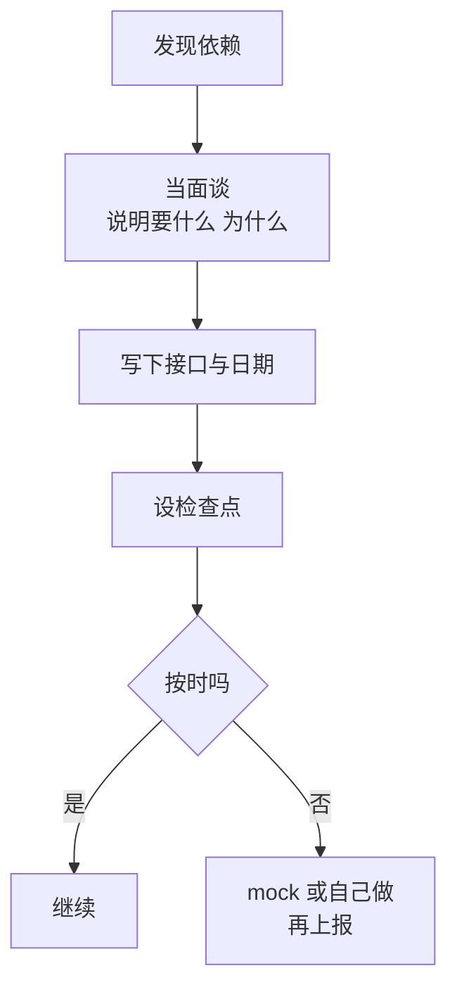

## Q
**Dependencies · 依赖别人的团队**｜原则 · 加分

你的项目需要平台团队先改一个接口，你给他们发了工单，两周没人理。项目还有六周交付。你怎么办？

## A
**原则：** 依赖是项目最常见的风险之一。要**尽早提、写清楚、设检查点**，同时准备一个**不依赖对方**的备选，让自己不被卡死。

**怎么做（工程依赖，常见缓解办法）：**
1. **先谈：** 和对方团队聊清楚需要做什么，不只是丢工单。
2. **自己做：** 如果公司有 internal open source（内部开源）模式，主动提出自己改。别低估时间，你需要对方服务的上下文，平台团队还有很多约束。
3. **mock：** 先对着假接口开发，对方做的同时不阻塞你。
4. **移出关键路径：** 自己做一个更简单的版本，但要想清楚之后的维护负担。
5. **全队突击：** 真难的问题可以让全队一起上。
6. **向上求助：** 让经理去协调对方的路线图优先级；**先试过工程师之间沟通**，再升级。

非工程依赖（法务、设计、业务）：说明你要什么、为什么、不处理的影响；能不能用占位物绕过；必要时请 PM 或 EM 帮忙，同时承认对方的约束。

**常见错法：**
- **只提工单、等回复：** 到期才发现没人排期。
- **一开始就升级：** 对方觉得你在告状，之后更难合作。
- **没有备选：** 对方延期，你的日期也跟着延。

**回到题目：** 直接找对方工程师，说明你的日期和不处理的后果；同时提出你来改，或先用 mock；把约定的接口和日期写下来，每周一个检查点；仍然不动，再带着两个方案找经理。

面试官看什么 · 配哪类故事 · 出处

**面试官在考什么：** 你推动依赖的方式：主动、尊重对方约束、有备选，而不是抱怨或绕过。

**适合配哪类故事：** 你的项目依赖别的团队，你用 mock、自己动手或明确约定把依赖风险化解的经历。

**出处：** Orosz《The Software Engineer's Guidebook》ch16 §6 "Risks and Dependencies"（Engineering dependencies、Non-engineering dependencies）

