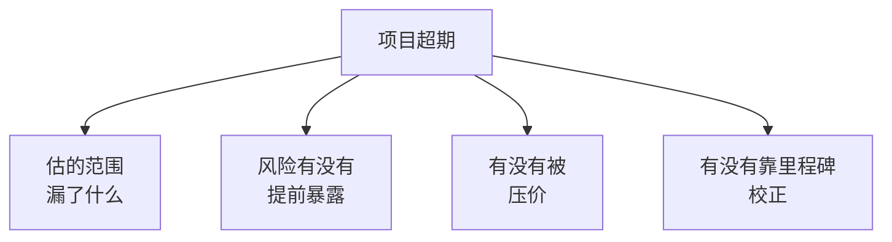

## Q
**Estimation failure modes · 为什么总是超期**｜原则 · 必会

团队连续三个项目都延期。回顾时大家说"估得太乐观了"。你被要求找出系统性原因并提出改法。你从哪里查起？

## A
**原则：** 超期很少是因为编码比想象慢，而是**估期漏掉了东西、没有校正机制、或是被压价**。逐类查，比一句"以后多估一点"有效。

| 常见原因 | 症状 | 改法 |
|---|---|---|
| 只估编码，漏掉评审、测试、发布、联调 | 代码按时完成，上线拖几周 | 估期里把这些列成单独任务 |
| 未知没处理 | "没想到它是这样的" | 把最大的未知拆出来，做原型或 spike |
| 依赖别的团队 | 卡在对方的排期上 | 提前提需求、写明日期，设检查点 |
| 被压价后直接点头 | 做之前就知道赶不上 | 谈范围、时间、人手的取舍 |
| 没有校正 | 到最后才知道落后 | 小里程碑，命中一个才知道偏了多少 |

**怎么做：**
1. 对比三个项目的估期和实际，按上面几类归因。
2. 估期里加上"非编码工作"清单。
3. 里程碑切小（几周以内），每次命中都复盘偏差。
4. 把风险写出来：技术、依赖、不现实的日期、人手不足、中途惊喜、不知道要多久。
5. 有新风险就调整，不要硬扛：范围、时间、人手至少要变一个。

**常见错法：**
- **说"以后随便多加一点"：** 没有依据的系数；该查的是漏了什么。
- **相信一次估期就对：** 所有估期都会有偏差，只有命中里程碑才知道偏多少。
- **隐瞒风险直到来不及：** 越晚暴露，选择越少。

**回到题目：** 从三个项目的任务记录里抽出"实际用时 − 估期"的差，按漏项、未知、依赖、压价、校正五类打标签；占比最大的那类就是第一个要改的流程。同时开始把里程碑切到几周以内。

**面试官在考什么：** 你能否从系统层面诊断估期问题，而不是责怪个人或泛泛地"多留 buffer"。

**适合配哪类故事：** 你复盘一次延期，找出结构性原因（漏项、依赖、压价）并改了流程的经历。

**出处：** Orosz《The Software Engineer's Guidebook》ch16 §6 "Risks and Dependencies"（八类风险）；ch16 §3 "Establishing milestones"（All estimates will be off by some degree）；ch7 §4
