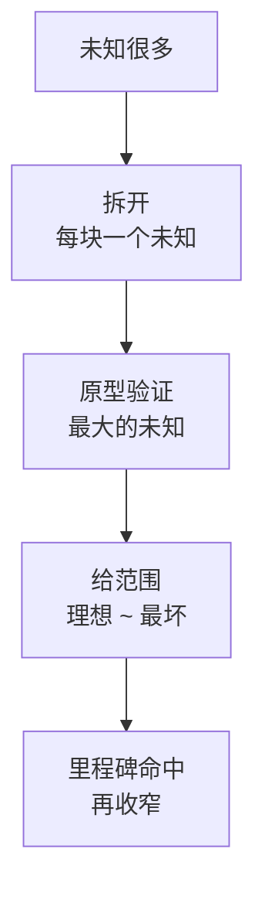

## Q
**Estimation · 给范围不给点**｜原则 · 必会

经理问你："接入这个外部风控服务，要多久？"你从没用过它的接口，文档也很薄。他想今天听到一个数字。你怎么回答？

## A
**原则：** 估期是**帮人做计划的沟通工具**，不是承诺。越多未知，越要把未知变小，再给**范围**（理想情况和最坏情况），而不是一个点。

| 工作类型 | 估法 |
|---|---|
| 和以前做过的类似 | 按上次实际用时 |
| 别人做过类似的 | 请他拆解，自己第一次做要估长一点 |
| 重构 | 参考同类经验，或 timebox（定好时间，到点就停） |
| 集成不熟悉的系统 | 先做原型再估；来不及就给"理想估期"和"最坏估期" |
| 新技术、大量未知 | 先原型，或拆成每块只含一个未知的小任务 |

**怎么做：**
1. 判断这是哪类工作，未知在哪里。
2. 被逼着当场回答，就给**最坏情况**的估期，并提议先花一小段 timebox 做原型，之后给准确的。
3. 对外讲清楚前提和未知：哪些是假设，哪些没验证。
4. 每个里程碑完成后，用实际用时校正，给出越来越有信心的日期。

**常见错法：**
- **给单一数字：** 一旦说出口就被当成承诺，一延期就是"失信"。
- **拒绝估期：** 业务需要靠日期做计划；可靠的工程师是估得准并讲清未知的人。
- **把没做过的事按做过的估：** 未知越多越不能直接套用。

**回到题目：** "我没用过它的接口，今天只能给范围：顺利的话一周，如果对方接口行为和文档不符、要做绕行，可能三周。给我两天做个原型调通下单和回调，周三我给你一个更准确的数字。"

面试官看什么 · 配哪类故事 · 出处

**面试官在考什么：** 你能否在不确定下沟通：既不拒绝，也不乱许诺，会用原型和范围把风险讲清楚。

**适合配哪类故事：** 你用原型或拆解把一个高度不确定的任务变成了较准确的估期，并在里程碑上校正的经历。

**出处：** Orosz《The Software Engineer's Guidebook》ch7 §4 "Estimate the Duration of Your Work"（七类工作的估法；ideal / worst-case estimate；timebox）；ch16 §3 "Ensure estimates aren't binding"

