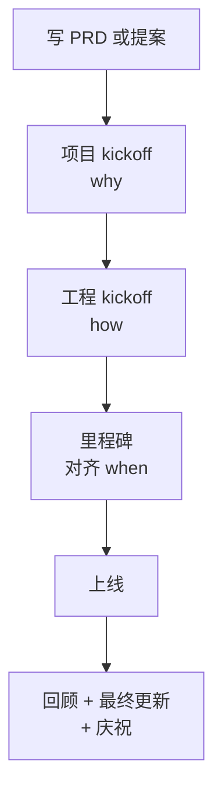

## Q
**Kickoff & closeout · 开头与收尾**｜原则 · 加分

你刚做完一个耗时四个月的项目，团队已经被派去做新东西，没有人复盘，也没有人告诉相关团队结果。你上次启动这个项目时只开了一个十分钟的碰头会。下一个项目你怎么开头、怎么收尾？

## A
**原则：** 项目常因**一开始期望不一致**而失败，又因**没有收尾**而不能积累经验。kickoff 对齐 why 和 what，closeout 把"done"落地并留下学习。

**怎么做：**
1. **启动前先写文档**，发给大家评论，远程团队尤其如此（PRD 讲 why/what）。
2. **project kickoff：** 请所有相关方，包括业务和客户支持；问"关于做什么、为什么、怎么做，有疑问吗？"房间里炸出一堆问题，恰恰说明它的价值。
3. **engineering kickoff：** 对齐 how，写成 RFC、ERD 或 ADR，随后用于新人上手。
4. **里程碑单独定：** 工程规划和日期分开，否则一上来就为赶日期留下 tech debt。
5. **收尾：** 清楚什么算 done（来自 kickoff）；做 retrospective；给更大范围写一份最终更新（为何重要、影响、工作概要、点名贡献者、链接细节）；发出前先找人看一遍；团队散伙后不久就发；庆祝。
6. **失败的项目也要收尾：** 以正面结束（我们完成了承诺的工作）、分享学到的东西和小胜利。

**常见错法：**
- **只开一个碰头会：** 关键相关方（法务、客户支持）没在场，做到一半被叫停。
- **没写 done 的定义：** 什么时候结束全凭感觉。
- **收尾不了了之：** 团队得不到认可，也没有学习。

**回到题目：** 开头用文档加 kickoff，邀请业务和客户支持；写好 done 的定义。收尾用复盘和一封点名的最终更新邮件，发给所有相关团队，并庆祝一下。

**面试官在考什么：** 你对项目完整生命周期的责任心，而不是只管写代码。

**适合配哪类故事：** 你用一次 kickoff 暴露了关键分歧，或用一个收尾总结让团队的成果被看见的经历。

**出处：** Orosz《The Software Engineer's Guidebook》ch16 §3 "Project Kickoffs and Milestones"；§7 "Wrapping Up Projects"
