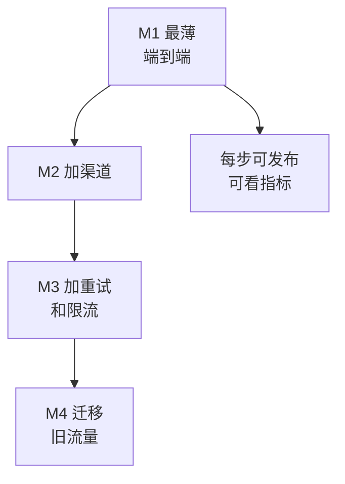

## Q
**Milestones & visible progress · 先打通最薄的一条**｜原则 · 必会

你负责重做用户通知系统（短信、邮件、推送），预计三个月。上级每两周问"进展怎么样"，你只能说"各模块在做"。怎么设计里程碑，让进度看得见、风险早暴露？

## A
**原则：** 里程碑要**小、可发布、能让项目离最终目标近一步**。先打通最薄的端到端，再加厚。命中里程碑，是知道估期偏多少的唯一方式。

**怎么做：**
1. 先把工程计划和里程碑日期分开做：计划先考虑长期系统健康，再估日期，否则一上来就为赶日期加捷径、欠技术债。
2. 里程碑尽量几周内能完成；太长就拆出中间里程碑。
3. 第一个里程碑做最薄的端到端：例如只有邮件一个渠道、一个模板，真的发给内部用户。
4. 每个里程碑后更新状态和日期，信心逐步增加；让业务知道没有"固定日期"，但有定期更新。
5. 反馈越频繁越好：小迭代、小里程碑、定期复盘。
6. 目标不是写代码或关 ticket，而是业务结果，经常把它说出来。

**常见错法：**
- **里程碑按模块划分：** "各模块 80%"没有任何可演示的东西，到最后才发现集成不起来。
- **里程碑太大：** 几个月才有一次反馈，等于瀑布式开发。
- **日期当成固定承诺：** 一延期就失信。

**回到题目：** M1（第 2 周）：邮件渠道端到端发给内部员工；M2：加短信、推送；M3：重试和限流；M4：迁移旧流量。每个里程碑后发一封进度邮件，包含已发布功能、风险、更新后的日期。

面试官看什么 · 配哪类故事 · 出处

**面试官在考什么：** 你会不会用小步交付让进展可见，并用里程碑校正估期，而不是靠汇报"在做"。

**适合配哪类故事：** 你把一个大项目切成能上线的小里程碑，因此提早发现问题或让利益相关方持续有信心的经历。

**出处：** Orosz《The Software Engineer's Guidebook》ch16 §3 "Establishing milestones"、"Ensure estimates aren't binding"；ch16 §5 "Day-to-Day Project Management"（Iterations and feedback）；ch7 §3

