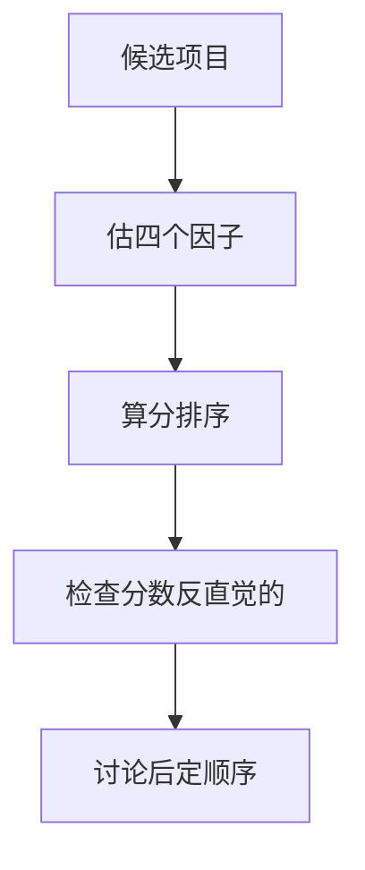

## Q
**Prioritization frameworks · RICE 的用途与局限**｜原则 · 加分

PM 给你十个想做的需求，每个都说"重要"，团队只有一个季度。你想用 RICE 打分排序。怎么用，什么时候不能全信分数？

## A
**原则：** 优先级框架是**把直觉摊开来讨论**的工具，不是自动做决定的公式。RICE 用"影响除以成本"排序，但每个输入都是估计。

**RICE（Intercom 的定义）：** 分数 = (Reach × Impact × Confidence) / Effort

| 因子 | 含义 | 刻度 |
|---|---|---|
| Reach | 一个时间段内影响多少人或事件 | 用真实指标，如每季度客户数 |
| Impact | 对每个人的影响 | 3 巨大、2 高、1 中、0.5 低、0.25 极低 |
| Confidence | 对上面估计有多确定 | 100% 高、80% 中、50% 低；低于 50% 视为"赌一把" |
| Effort | 产品、设计、工程总投入 | 人月，整数，或 0.5 |

**怎么做：**
1. 每个项目填四个因子，**写下依据**（Reach 用实际指标）。
2. 排序后，看**反直觉的结果**：重新核对估计，或接受直觉可能是对的。
3. 先做的不一定是分高的：有**依赖**关系，或是**不做就没法竞争**的基本功能（table stakes）。
4. 同时对照自己的 #1 优先级：保证最重要的事一定做完，其他再按分排。

**局限：**
- Impact 靠判断，不是科学测量；Effort 是粗估，不要在估期上纠缠细节。
- 分数给人精确的错觉；决定仍要谈。
- 技术债、可靠性这类收益不好量化的工作，在 RICE 里常被压低，要用业务语言补上。

**常见错法：**
- **把分数当结论：** 排完就不讨论。
- **所有人都给自己的项目高 Impact：** 没有统一刻度和依据。
- **只做分高的，忽略依赖：** 平台前置工作永远排不上。

**回到题目：** 对十个需求打分，把低 Confidence 的先做小实验提高信心；分数和直觉不一致的拿出来讨论；有依赖的前置项目单独标出。

**面试官在考什么：** 你是否理解框架的用途，也明白它的局限，并能带着相关人一起讨论。

**适合配哪类故事：** 你用一个排序方法帮团队在多个诉求中做出取舍，并说服了不同意的人的经历。

**出处：** Intercom《RICE: Simple prioritization for product managers》（intercom.com/blog/rice-simple-prioritization-for-product-managers/，2026-11-21 读取：因子定义、刻度、caveats；页面把公式画成图，公式按其"total impact per time worked"描述整理）；Orosz《The Software Engineer's Guidebook》ch7 §1（该书未讲 RICE，只讲先完成 #1 优先级）
