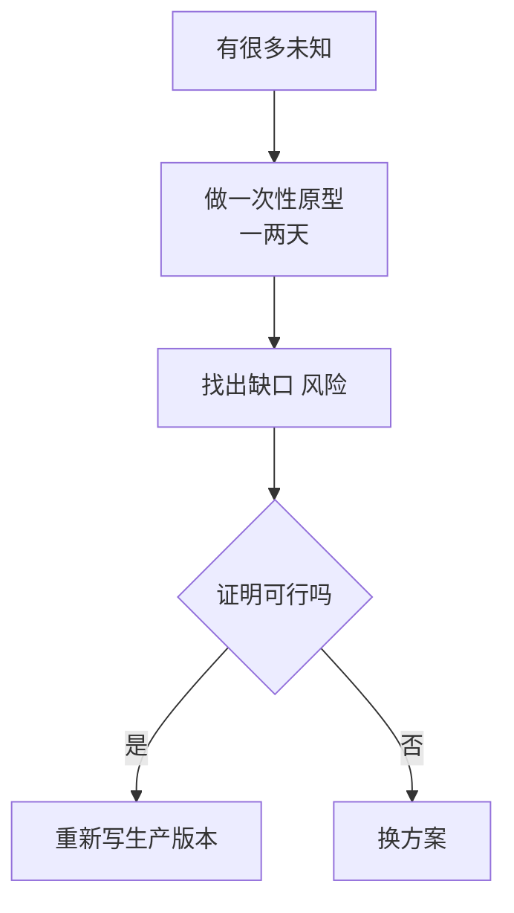

## Q
**Prototyping & proof of concept · 做多粗、怎么丢**｜原则 · 加分

你要对接一个没用过的第三方物流 API，不确定能不能满足需求。你做了两天的 prototype，演示后产品经理说"看起来可以了，直接上线吧"。你怎么办？

## A
**原则：** prototype（原型）是**探索工具**：用具体代码回答"能不能行"，**用完就丢**。不要把它当成品。

**怎么做：**
1. **何时做：** 有很多未知或活动部件、没有足够信息做高信心计划时。例如：要集成第三方 API，但不确定怎么集成，就写一个调用它的原型，给出集成建议。技术风险高时花一两天做原型，会暴露缺口和 unknown unknowns。
2. **做到多粗：** 只证明关键问题。不需要 code review、自动化测试、可维护性；这正是它快的原因。
3. **明确标注为一次性：** 让所有人知道它不上线。
4. **怎么丢：** 验证后从头写正式版本，有了原型这并不难。
5. **有上线压力时：** 坚持拒绝发布原型；也可以有意用不上线的技术栈写（团队后端用 Go，就用 Node.js 写原型）。
6. **用原型再估期：** 估算不熟悉的工作前先做原型，再给估期。

**常见错法：**
- **原型悄悄变成生产代码：** 没有测试、没有评审，之后全是债。
- **在原型里追求优雅：** 失去快速的意义。
- **没有明确问题：** 做了很多，不知道想证明什么。

**回到题目：** 感谢反馈，说明"这个原型没有错误处理、测试和监控，直接上线会出事故；我需要两周写正式版本，原型帮我们把风险降到了很低"。如果压力很大，就把下一个原型用别的技术栈做。

**面试官在考什么：** 你会不会用最小成本消除不确定，并对产品化有底线。

**适合配哪类故事：** 你用原型验证了一个高风险想法，并坚持重写而不是上线原型的经历。

**出处：** Orosz《The Software Engineer's Guidebook》ch15 §2 "Prototyping and Proof of Concept"（"Build with the intent to throw it away"）；ch16 §6（Technology risk：Prototype a day or two）；ch7 §4
