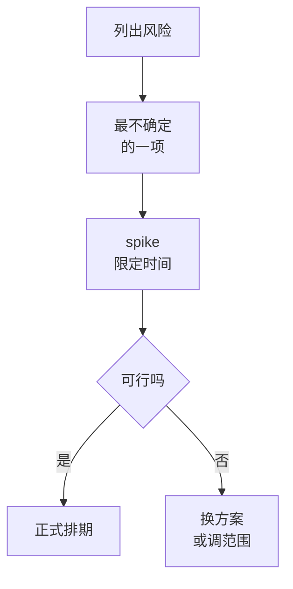

## Q
**Risk first · 最不确定的先做**｜原则 · 必会

一个项目要用你们没用过的新消息队列来替换现在的任务系统，另外有很多普通的 CRUD 接口。排期时有人说"先把简单的做完，队列最后接"。你怎么看？

## A
**原则：** 项目早期最贵的东西是**未知**。把最不确定的部分**前置**，用一个小的、有时间上限的 spike（探路实验）去验证，才能在还来得及时调整方案、日期或范围。

**怎么做：**
1. 列出风险：技术风险（没用过的技术）、依赖、缺少决定或背景、不现实的日期、人手、"不知道要多久"。
2. 选出最不确定且影响最大的，花一两天做 spike：原型调通关键路径，发现差距和未知。
3. 同时评估：这个技术是否稳定、路线图上有没有破坏性变化、维护投入如何、有没有更稳妥的替代。
4. 在 spike 结论出来前，不承诺这一块的日期。
5. 无法消除的风险，写下来并告诉干系人，带上应对办法。

**常见错法：**
- **先做简单的：** 进度看起来好看，但最大的风险拖到最后，一旦失败整个项目没有退路。
- **spike 没有时间上限：** 变成无休止的研究。
- **在缺少关键决定或背景时开工：** 做出来的东西多半要返工。

**回到题目：** 先花两天对新队列做 spike：写一个最小生产者和消费者，测延迟、重试、顺序性、运维方式。结论出来再排期。如果不行，趁早换方案；CRUD 部分随时可以并行做。

**面试官在考什么：** 你的优先级是"消除不确定"，而不是"让进度好看"。

**适合配哪类故事：** 你把最大的未知提前验证，因此避免了后期推翻方案或大幅延期的经历。

**出处：** Orosz《The Software Engineer's Guidebook》ch16 §6 "Risks and Dependencies"（Technology risk；No true idea how long something will actually take；"doing a spike"）；ch15 §2 "Prototyping and Proof of Concept"
