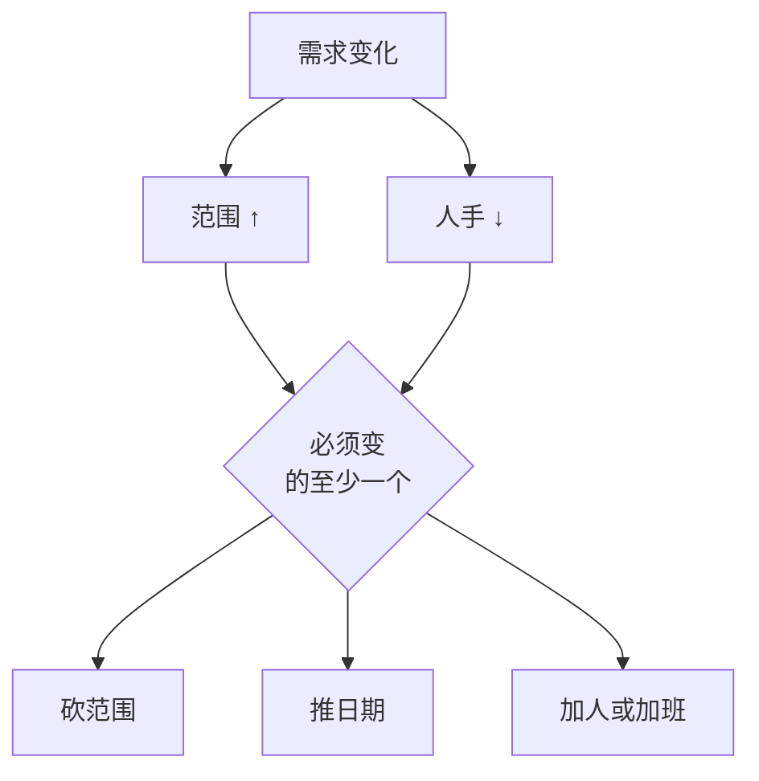

## Q
**Scope negotiation · 时间、范围、人手**｜原则 · 必会

项目进行到一半，产品加了两个新需求，同时一位同事被调去支持线上故障。截止日期不变。经理说："大家这两周加加班吧。"你怎么回应？

## A
**原则：** 项目的**时间、范围、人手**互相牵制：任何一个变了，至少另一个也要变。谈的不是"能不能"，而是"砍什么"。

| 变化 | 你的选择 |
|---|---|
| 范围增加 | 延长时间，或加人（含加班） |
| 日期提前 | 砍范围；人手事实上会增加（加班），代价被隐藏 |
| 人变少 | 减范围、延期，或加其他人的工时 |
| 新人加入 | 时间不一定缩短：onboarding 越快，越可能提速 |

**怎么做：**
1. 把 triangle 摆给经理：新增两个需求 + 少一个人，三个量里至少两个要动。
2. 提出具体选项：先不做哪个新需求、日期推多久、哪些人可以来帮。
3. 加班要当成"人"这一栏的成本：长期加班增加错误和倦怠，一个累垮的人带来的回归可能比他贡献的还多。
4. 加人要考虑 onboarding 和沟通成本：有领域知识、工作能并行时才有效；不是人数翻倍时间减半。
5. 对大多数团队，质量不是谈判项，时间和范围才是。

**常见错法：**
- **说"好的我们加班"：** 把成本藏在人身上，没人讨论范围。
- **说"做不到"：** 只拒绝不提方案。
- **加人救火：** 不考虑 onboarding，常常更慢。

**回到题目：** "新增两个需求、少一个人，这两周加班只能补一部分。我建议：A 需求这版先不做，B 保留；日期推三天；或者你能不能让 X 同学回来帮两天。三选一我都能执行，但是继续加班会带来质量风险。"

面试官看什么 · 配哪类故事 · 出处

**面试官在考什么：** 你能否用取舍与干系人谈，而不是默默承受或拒绝。资深的信号是"选择砍什么，而不是加班"。

**适合配哪类故事：** 你在压力下提出了范围或日期的替代方案，既保证了关键目标，又保护了团队的经历。

**出处：** Orosz《The Software Engineer's Guidebook》ch16 §4 "Software Project Physics"（When scope increases；When the project timeline changes；When fewer people can work on a project；When people working on the project change）

