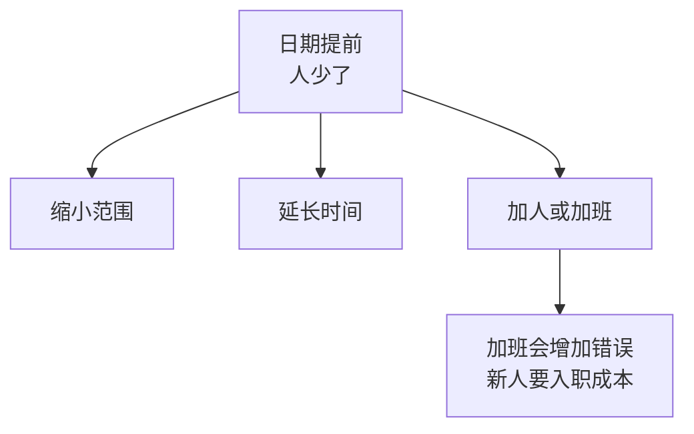

## Q
**Software project physics · 一角动，另一角必动**｜原则 · 加分

项目做到一半，一个核心同事被调去救火三周；同时业务又要求把上线日期提前一周。你怎么回应？

## A
**原则：** Orosz 的 "software project physics"：**timeline、scope、people** 三者相连，**一个变，至少另一个要变**。在 Big Tech 和高速增长的创业公司，质量很少是可协商的，所以可协商的是时间和范围。

**怎么做：**
1. **说清哪一角变了：** "少了一个人三周，日期又提前一周。"
2. **逐一摆出选项：** 缩小范围；延后日期；加人（需要有领域知识、工作可并行、人数相对团队少，才不会拖慢；Brooks 说"给晚了的项目加人只会更晚"，认为这不是普遍真理）。
3. **识别隐藏的"加人"：** 日期提前或人变少时，常见的做法是加班，这实际增加了 people 一角。持续加班会烧尽，也增加错误。
4. **新人不等于更快：** 新人入职要时间，若还是公司新人，可能拖累整个团队；有的公司新人第二天就能上线，有的要 1–2 个月。
5. **带着选项找业务谈，让他们选：** 不是你扛下来。

**常见错法：**
- **只答应不说代价：** 范围、日期都不变，实际是加班。
- **以为人多就快：** 人数翻倍不会让时间减半。
- **牺牲质量：** 悄悄删测试和评审，换来更大的事故。

**回到题目：** "日期提前一周且少一个人，范围不变不可能。选项 A：砍掉 X 功能，按新日期；选项 B：日期不变，范围按原计划，但推迟一周；选项 C：加两位有领域经验的人，但他们需要一周入职，收益有限。你选哪个？"

**面试官在考什么：** 你是否用清晰的模型和业务谈判，而不是默默加班。

**适合配哪类故事：** 你面对被压缩的日期，用选项谈判，最终缩小范围、按时交付核心价值的经历。

**出处：** Orosz《The Software Engineer's Guidebook》ch16 §4 ""Software Project Physics""（When scope increases / the timeline changes / fewer people / people change；Brooks 引文）
