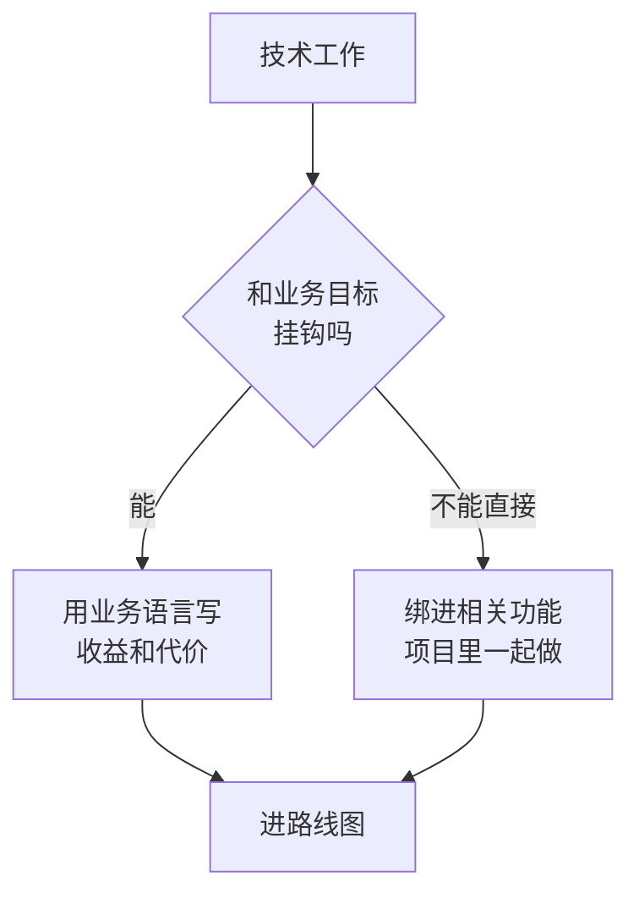

## Q
**Technical roadmapping · 把技术债放进业务语言**｜原则 · 加分

你的团队想花一个季度重构订单服务，理由是"代码很乱"。经理说业务季度目标已经排满，没位置。你怎么把它排进路线图？

## A
**原则：** 单独的"改善架构"很难成为足够的业务理由。要**把技术工作和业务目标挂钩**：说明它带来的**收入、成本、风险、速度**，或把它绑在业务关心的项目上一起做。

**怎么做：**
1. **先问业务痛点：** 例子：加一种支付方式要两个月，而业务一年要加 20 种；或支付故障造成客户流失。有这样的痛点，重新设计架构就有理由。
2. **没有业务痛点，就不要大改：** 变更有成本和风险，要有收益。
3. **翻译成业务语言：** "加支付方式从两个月缩到两周，今年可多接 X 个渠道"，比"解耦模块"有力。
4. **绑定业务项目：** 做新功能时顺便改善相关架构，让它更稳、下次加类似功能更快。
5. **提升工程效率、减少 toil（重复性的手工运维）也是有效的理由**，但要排在清单高位。
6. **对齐 North Star 和 KPI：** 知道团队的目标和指标，路线图上的每项工作才有落脚点。
7. **good enough 就好：** 架构可以改，但改动更贵；别追求完美。

**常见错法：**
- **用技术词争取时间：** "重构、解耦"对管理层没有意义。
- **一次要整个季度：** 先要一个能量化收益的小切片。
- **和业务对立：** 把业务需求说成"阻碍"。

**回到题目：** 找出订单服务拖累业务的具体数字（加功能的周期、事故次数），把重构拆成与两个即将上线的业务功能绑定的部分，对经理讲"能多快、少几次事故"，而不是"代码很乱"。

面试官看什么 · 配哪类故事 · 出处

**面试官在考什么：** 你是否能把技术工作翻译成业务价值，并争取到资源。

**适合配哪类故事：** 你把一项技术债或平台工作，借业务项目或量化收益推进下去的经历。

**出处：** Orosz《The Software Engineer's Guidebook》ch25 §7 "Architecture Decisions vs Business Priorities"（"Align architecture decisions with the business's goals"、"Tie architecture changes to business initiatives"、"Good enough may be better than perfect"）；ch21 §1 "Northstars, KPIs, OKRs"

