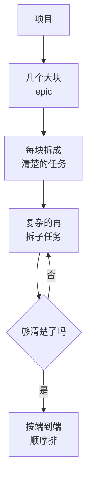

## Q
**Work breakdown · 竖切片**｜原则 · 必会

你要在后端给应用加"两步验证"（登录时除密码外再输一次短信验证码）。同事的拆法是：1 建数据库表，2 写所有接口，3 写所有前端页面，4 联调。你会怎么拆，为什么？

## A
**原则：** 把大活拆成**能验证、能更快跑通的小块**，并且排序时优先做"离可运行功能最近"的。越早有东西能端到端测试，越早知道方向对不对。

| 横向拆（按层） | 竖向拆（按切片） |
|---|---|
| 先建全部表、再写全部接口 | 先做最重要的一条用户流程，只用到所需的表、接口、页面 |
| 最后联调才知道哪里错 | 第一个切片就能端到端跑通 |
| 中间没有能演示的东西 | 每个切片都能上线或演示 |

**怎么做：**
1. 先高层：这个项目有哪些主要部分（epic / story）。两步验证例子：添加验证方式、用验证码登录、处理错误和边缘情况。
2. 每个部分再拆成清楚的任务，复杂的再拆子任务。拆到你自己觉得"清楚了"就停，不要钻进最小的编码细节。
3. 想办法再拆小：例如先做一个只走最主要流程的版本（golden path），把边缘情况拆成另外的任务。
4. 排序：先做能最快得到端到端可运行功能的任务。
5. 任务只是组织工作的工具，发现新工作、旧任务过时，就改计划；花在管任务上的时间不要超过写代码。

**常见错法：**
- **按层拆：** 看起来整齐，但集成风险都堆到最后。
- **拆过头：** 一直拆到编码细节，花的时间比写代码还多。
- **死守任务清单：** 做到一半发现需要新工作，却因"任务没写"而不做。

**回到题目：** 第一个切片：只支持短信验证码，一个设备，跑通"开启 → 登录验证"的主流程，数据库只加这个切片要用的字段。之后再加备用码、重发限流、失败锁定、多设备，每个都是独立切片。

面试官看什么 · 配哪类故事 · 出处

**面试官在考什么：** 你能否把大工作变成可验证、能尽早拿到反馈的小步，而不是一条长长的、最后才联调的流水线。

**适合配哪类故事：** 你把一个大项目拆成可以逐步上线的小块，早期就拿到真实反馈并据此调整方向的经历。

**出处：** Orosz《The Software Engineer's Guidebook》ch7 §3 "Break Down the Work"（Think about stories, tasks, and subtasks；Prioritize work which gets you closer to shipping something；Don't be afraid to add, remove and change tasks）

