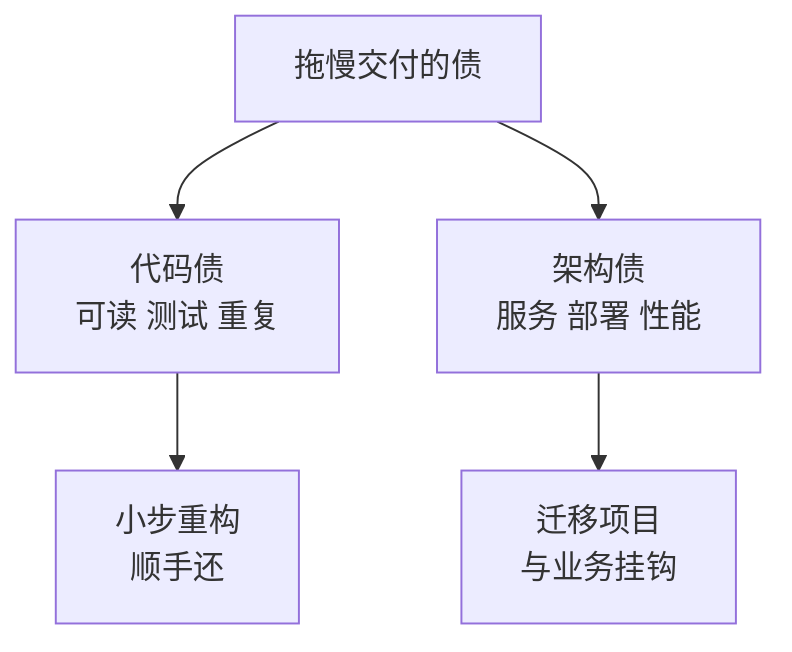

## Q
**Architecture debt vs tech debt · 两种债**｜原则 · 加分

经理问："我们的债到底是什么？为什么每个季度都在还，还是慢？"一个同事说是代码质量；你觉得其实是服务划分和部署方式的问题。你怎么向经理区分？

## A
**原则：** **tech debt（代码债）**让代码难读、难改；**architecture debt（架构债）**是旧的架构决定让**扩展、维护甚至运行**变慢，是 tech debt 的一种，但利息和偿还方式不同：改一个函数能还代码债，改服务边界要的是跨团队的迁移。

**怎么做：**
1. **识别架构债的四类例子：** 为快而建的独立小服务（各用各的语言、依赖版本，改动要找对服务）；不拆的单体（团队变大后合并冲突多、只能整体部署）；非功能问题（性能、可扩展性、可靠性随负载恶化）；过时的语言或框架（不再被维护、安全与兼容性风险）。
2. **没人有意制造：** 当时合理的决定，随时间变得次优。
3. **旧技术不自动等于债：** 稳定但不时髦的语言和框架意外少。
4. **偿还不同：** 代码债适合小步重构，bundle 到高影响项目里；架构债往往需要迁移项目，要和业务目标挂钩，并像迁移一样分阶段。
5. **用"利息"说话：** 对经理描述每一项债让交付多慢、多少事故，而不是"代码乱"。

**常见错法：**
- **把所有债都叫 tech debt：** 解决方案和规模不同。
- **对架构债只做局部重构：** 没有触及根因。
- **一次性大迁移：** 忽略迁移风险。

**回到题目：** "您看到的慢，主要是架构债：十五个小服务各自部署，每次改一个功能要动三个服务。要还它需要一个迁移项目，我们把它和下季度的两个业务功能绑定，分阶段合并；代码债我们每周顺手清理。"

**面试官在考什么：** 你是否能把债分类并给出不同的偿还路径。

**适合配哪类故事：** 你诊断出某个拖累交付的问题其实是架构债，并用迁移方案解决的经历。

**出处：** Orosz《The Software Engineer's Guidebook》ch25 §3 "Architecture Debt"（#1–#4）；ch13 §3 "Tech Debt"
