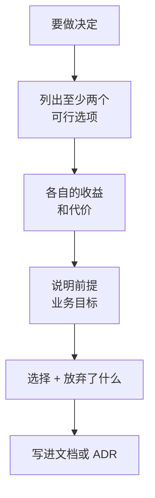

## Q
**Articulating trade-offs · 说清放弃了什么**｜原则 · 加分

你在 design review 上说"我们选方案 B"，有人问："为什么不选 A？"你发现自己只能说 B 的好处。怎么把一个决定讲成资深工程师的水平？

## A
**原则：** 一个决定的价值在于**你放弃了什么**。只讲选了什么，别人无法判断你是不是看过其他选项；说清代价和前提，才能让别人信任，也方便将来在前提变了时回头改。

**怎么做：**
1. **想不止一个方案：** 即使有显而易见的做法，也强迫自己找替代，例如用配置而不是改代码、用灰度而不是直接上线。
2. **讲取舍时挂上业务背景：** 架构选择要对应业务目标。例子：加一种支付方式要两个月，而业务一年要加 20 种，重做架构才有理由；业务没有这个痛点，就没有大改的理由。
3. **说出"放弃"：** 例如"选 B 换来上线快，放弃了可扩展性，如果一年内要加 10 个以上渠道，我们要重新评估。"
4. **和 PM 一起谈产品与工程取舍：** 提出"砍掉哪个功能换日期"这种选项，让业务选，不是工程悄悄决定。
5. **指导别人时也这么做：** 帮对方想出多种方案并说清取舍，解释概念而不是直接给解。
6. **good enough：** 架构可以随业务演进，不必追求完美。

**常见错法：**
- **只讲优点：** 听起来像是在推销，而不是在判断。
- **取舍太抽象：** "更灵活""更好维护"没有信息量，要有具体的成本、时间、风险。
- **默默做取舍：** 把"为了赶日期降低质量"当成自己的责任，不告诉业务。

**回到题目：** "A 的好处是……代价是……；B 的好处是……代价是……。现在业务目标是 X，所以我选 B，放弃 A 的 Y。如果前提 Z 变了，我们会重新看 A。"并把它记在文档里。

**面试官在考什么：** 你的判断是否透明、有依据，而不是靠资历说服。

**适合配哪类故事：** 你面对多个可行方案，把取舍摆到桌面上，让团队或业务做出选择（并在之后验证了前提）的经历。

**出处：** Orosz《The Software Engineer's Guidebook》ch25 §7 "Architecture Decisions vs Business Priorities"；ch16 §6（Unrealistic timeline 里的取舍话术）；ch12 §3 "Mentoring"（"Help mentees come up with multiple solutions…articulate tradeoffs"）；ch11 §4（product/engineering tradeoffs）
