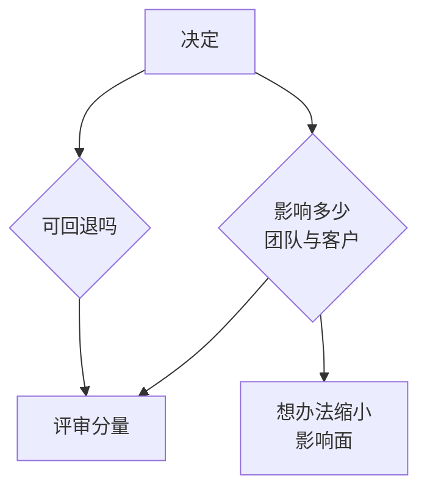

## Q
**Blast radius of decisions · 影响面**｜原则 · 加分

你想下线一个旧的 API endpoint，二十个内部团队和一批付费客户在用它。你在评审会上被问："这个决定要多重的评审？"你怎么回答？

## A
**原则：** 除了"能不能回退"，**影响面（blast radius）**也决定评审的分量：多少团队和客户会被这个决定影响。影响面大的决定更难执行，也更需要认真评审和沟通。

**怎么做：**
1. **估影响面：** 重构只有你们团队用的系统，影响面小；下线 20 个团队在用的 endpoint，影响面大；公开 endpoint 有 10 万客户，更大。
2. **大影响面为什么难：** 要改代码的团队会推回你的时间线；破坏付费客户的功能可能造成流失。
3. **缩小影响面的方法：** 例如对内下线、对外保留 endpoint，放一个适配器翻译到新接口；或用新功能鼓励客户主动迁移。
4. **列出所有选项和取舍：** 缩小影响面的方案不一定最优，要看上下文。
5. **好的架构决定会限制将来纠正的影响面：** 逆转单向门的决定往往影响面很大。
6. **没有万能配方：** 遇到不可避免的大影响面，要提前沟通、给出迁移时间。

**常见错法：**
- **只看技术难度：** 不盘点谁在用。
- **直接通知下线日期：** 没有迁移路径，下游全力反对。
- **把大决定当小决定走轻评审。**

**回到题目：** "单向门：基本不可回退。影响面：二十个团队加外部客户，大。所以需要 design doc、涉及团队的评审，并且我们先做适配器，对内迁移完成后再谈对外下线。"

**面试官在考什么：** 你是否能系统地评估决定的风险，不只是回退成本。

**适合配哪类故事：** 你通过盘点依赖、做适配器或分阶段，让一个影响面很大的变更平稳落地的经历。

**出处：** Orosz《The Software Engineer's Guidebook》ch25 §5 "The Blast Radius of Decisions"；§4 "One-Way Door vs Two-Way Door Decisions"
