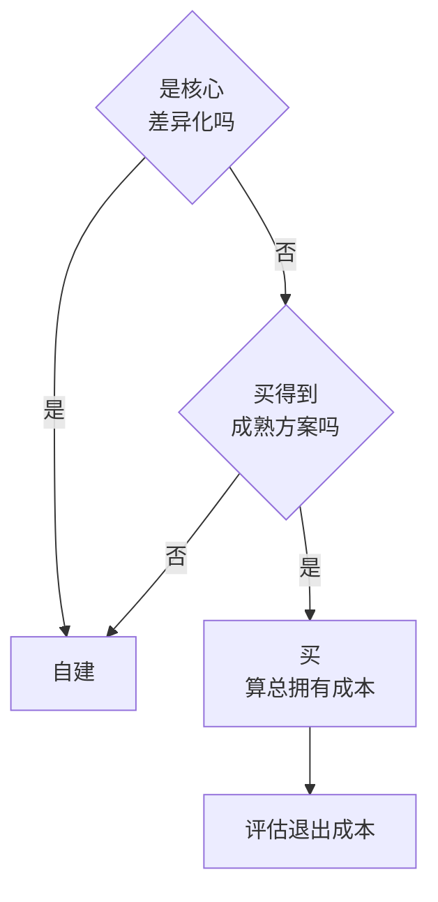

## Q
**Build vs buy · 自建还是买**｜原则 · 必会

团队要给产品加上"客服工单系统"，并且工单要能按用户权限读取业务数据。一位同事想自己写，另一位想买现成的 SaaS。你怎么帮团队决定？

## A
**原则：** 看这件事是不是**核心差异化**：核心的自己做，成熟通用的（commodity，大家都有、没有竞争力）买。买的时候要把**耦合、限制和退出成本**算进去，不只是订阅费。

| 选择 | 好处 | 代价 |
|---|---|---|
| 买（第三方平台） | 供应商能比你投入更多去做工具 | 和平台紧耦合；受平台限制；要养一支既懂你的技术栈又懂平台的团队 |
| 自建 | 完全贴合、可无限扩展 | 全部功能自己做、自己维护，长期占人力 |
| 混合 | 第三方管大部分动作，自己的系统管资源级权限，避免过深耦合 | 集成要设计清楚，两边要对得上 |

**怎么做：**
1. 先回答：这是不是我们的竞争力所在？核心业务功能自己做；通用的、成熟的功能优先买。
2. 算**总拥有成本（TCO）**：订阅费 + 集成 + 维护的人力 + 平台限制带来的绕路。
3. 算**退出成本**：以后要换供应商或自己接手，数据和流程能不能带走。
4. 对买来的东西设一层自己的接口，减少锁定。
5. 把决定和理由写成 ADR；如果换起来很贵，按 one-way door 对待。

**常见错法：**
- **什么都自己写：** 为了"可控"，把人力耗在别人早就做好的东西上。
- **什么都买：** 核心能力被外包，既没有控制力，供应商的优先级和你不同时你无能为力。
- **只比价格：** 忽略集成、维护、限制和迁出的成本。

**回到题目：** 工单本身是通用功能，买平台；但"按用户权限读业务数据"是和你产品深度绑定的部分，采用混合方案：工单在第三方平台，数据访问由自己的系统根据工单状态授权。这样不需要自建整套工单系统，也不被平台绑死。

面试官看什么 · 配哪类故事 · 出处

**面试官在考什么：** 你有没有判断"哪些是核心"的框架，并且知道购买的真实成本不只是账单。

**适合配哪类故事：** 你推动在"自建"与"采购"间做出明确决定，并写清了取舍和退出方案的经历。

**出处：** Larson《Crafting Engineering Strategy》ch19 Document 19-1（Customer data access strategy：三种做法与各自代价）；ch4（"Prefer vendors for commoditized functionality"）；Joel Spolsky《In Defense of Not-Invented-Here Syndrome》（"If it's a core business function — do it yourself"）

