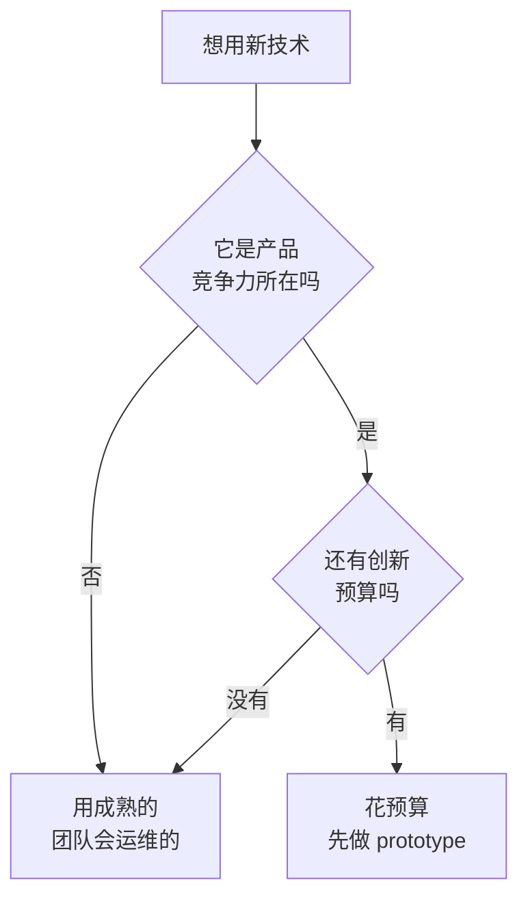

## Q
**Choose boring technology · 创新预算**｜原则 · 必会

一位同事想把你们新服务的数据库换成一个刚出的、社区很热的分布式数据库，"性能更好，简历也好看"。团队只有五个人，没人运维过它。你怎么回应？

## A
**原则：** 每个团队**可用来"做新奇、困难的事"的能力有限**，可以想成一小撮"创新代币"（innovation tokens）。要花在**真正让产品有竞争力的地方**，其他地方选成熟、团队会运维的技术。

**怎么做：**
1. 先问：这件事是不是我们的差异点？数据库通常不是。
2. 数一数团队已经在"新奇"的地方花了多少：每多一个新技术，就多一类故障、一套要学的运维知识。
3. 稳定但不时髦的技术有一个被低估的好处：意外更少，阻塞更少；用新技术可能踩到别人还没遇到、也没有修复的问题。
4. 评估成熟度：路线图上有没有破坏性变更？有多少维护投入？是否 stable 版本，而不是 alpha 或 beta？
5. 要用就当成 one-way door：先做原型，从小范围开始。
6. 架构从简单开始，不为了术语而复杂化。

**常见错法：**
- **为了简历选技术：** 成本由团队承担，好处只给个人。
- **一律拒绝新东西：** 创新预算是用来花的，只是要花在关键处。
- **没人会运维就上线：** 出故障时没有人知道怎么办。

**回到题目：** "它很吸引人，但数据库不是我们的竞争力，团队也没有运维经验。我们的创新预算花在 X 上。如果你想验证性能收益，可以做一个原型和压测，用数据说话；没有明显的、我们的瓶颈解决不了的问题，就继续用现有的。"

**面试官在考什么：** 你对技术选型有"成本意识"，知道选择要服务于产品和团队能力，而不是追新。

**适合配哪类故事：** 你否决或推迟了一个时髦但不必要的技术引入，或者在关键点上有意识地花了一次"创新预算"的经历。

**出处：** Dan McKinley《Choose Boring Technology》（boringtechnology.club，innovation tokens）；Orosz《The Software Engineer's Guidebook》ch25 §1 "Keep It As Simple As Possible"、§3 Architecture Debt #4（"stable if unfashionable"）；Larson《Crafting Engineering Strategy》ch4（示例策略条目 "Choose boring technology"）
