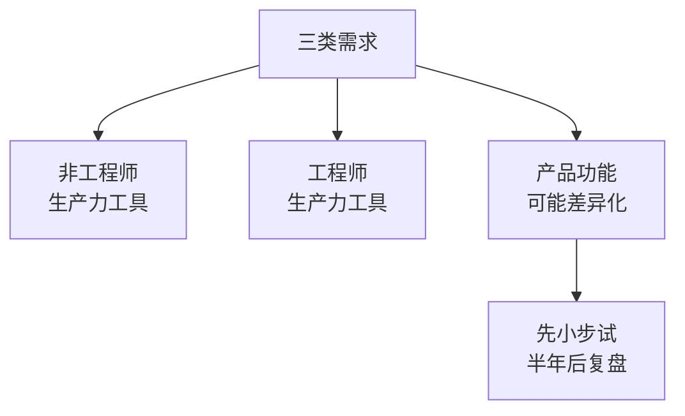

## Q
**LLM adoption strategy · 团队怎么引入大模型**｜原则 · 加分

公司里三波人同时要求"上大模型"：行政想用它改写文档，工程师想要 Copilot 类工具，产品想在核心流程里加抽取功能。CTO 让你定一个策略。你怎么回答？

## A
**原则：** 先**诊断**，再定政策：区分几类不同的需求，找出哪个可能成为差异化，承认团队经验有限，**不做不可逆的大投入**，先学习，并定期复盘。

**怎么做（案例 Document 17-1）：**
1. **诊断：** 至少三类需求：非工程师工具、工程师工具、产品扩展；产品扩展可能是战略差异化，其余是效率优化。
2. **承认经验有限：** 公司内外规模化、差异化地使用 LLM 的案例还很少；先发展经验，而不做不可逆的承诺。
3. **用 systems modeling 找杠杆：** 案例中的模型显示，让司机入职更快对活跃司机数量影响很小，重新激活流失司机才是杠杆。
4. **用 Wardley map 看生态：** 切换基础模型和供应商成本低、API 相近，所以起步先选一个，避免维护多套实现；自己训练基础模型太贵，不考虑。
5. **政策要具体：** 指定先用哪个供应商、例外由谁审、哪个团队必须提供至少一个工具、**六个月后刷新政策**、定期汇报进展。

**常见错法：**
- **追热点：** 没有诊断，直接买工具。
- **一次性大投入：** 在能力不足时，风险高、回报低。
- **没有刷新机制：** 模型和供应商变化很快，政策很快就过时。

**回到题目：** "三类需求分开处理：给所有人一个通用工具，给工程师一个编码工具，产品团队选一个高价值场景做试点；先用一家供应商，半年后看数据再决定是否加码。"

**面试官在考什么：** 你面对新技术浪潮的判断：不盲目，也不拖延。

**适合配哪类故事：** 你在新技术（LLM、云、新框架）引入时，用试点和复盘代替一次性押注的经历。

**出处：** Larson《Crafting Engineering Strategy》ch17 "LLM Adoption Strategy"（Document 17-1 Policy / Diagnose；17-2 系统模型；17-3 Wardley map；17-4）
