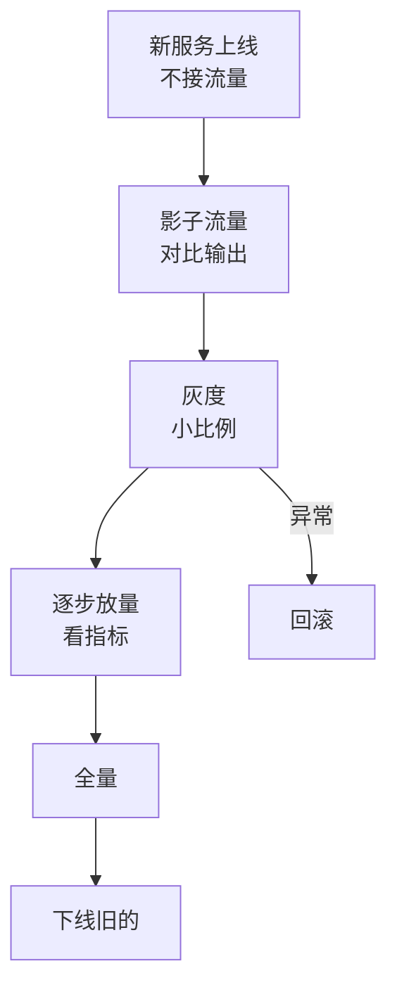

## Q
**Migrations · 不要一次切完**｜原则 · 必会

你们要把核心支付流程从旧服务迁到新服务。有人提议周末停机一晚，一次性全部切过去。你怎么设计迁移？

## A
**原则：** 迁移是 one-way door 的典型：**让新旧并行、小步切换、随时可回头，最后才下线旧的**。一次切完把全部风险压在一个时点上。

**怎么做：**
1. **影子（shadow）：** 新系统收到同样的请求，但结果不用，只和旧系统比对差异。差异要查清楚：例如发现某国货币转换缺失，上线就会多收钱。
2. **灰度（canary）：** 把一小部分流量路由到新版本，监控健康指标，没异常再继续。
3. **分阶段放量：** 每阶段设通过标准：没有意外回归，业务指标符合预期。
4. 用 feature flag 控制范围，迁完后把用完的 flag 清掉，否则越积越多。
5. 数据迁移是"在中间"的决定：能回退，但很贵。设计时保留回退路径，对数据做校验。
6. 迁移要有人天天看：定期复查进度和是否需要调整方案；能让别人自助迁移的，做成自助。
7. 写进 design doc，影响大的记 ADR。

**常见错法：**
- **周末一次性切换：** 一旦出问题，回退又是一次迁移。
- **没有对比验证：** 靠"测试通过"就放量，真实数据里的边缘情况漏掉。
- **旧系统过早下线：** 失去回退手段。
- **迁移拖成无限期：** 没人负责，新旧两套长期并存，成本翻倍。

**回到题目：** 提出分阶段：先让新服务接影子流量，对比订单金额和状态，两周内差异清零；再灰度一小部分内部或低风险用户；逐步放量，每步看支付成功率和延迟；全量稳定一段时间后才关旧服务。停机夜只留给无法并行的部分（如果真有的话）。

面试官看什么 · 配哪类故事 · 出处

**面试官在考什么：** 你知道迁移的风险在"切换"本身，并用并行、灰度和回退来降低。

**适合配哪类故事：** 你主导一次不停机的迁移，通过影子对比或灰度发现了问题，并平稳下线旧系统的经历。

**出处：** Orosz《The Software Engineer's Guidebook》ch17 §4 "Additional Verification Layers"（#5 Canarying、#6 Feature flags、staged rollouts）；ch11 §1（shadow outputs 的迁移验证例子）；ch25 §4 "In-between decisions"；Larson《Crafting Engineering Strategy》ch16 Document 16-1（迁移策略：先把流程做成自助、定期复查指标）

