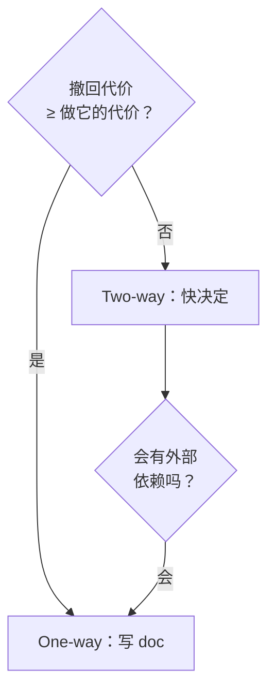

## Q
**One-way vs two-way doors**｜原则 · 必会

同一周里有两个提议：A 组想把单元测试框架从 unittest 换成 pytest；B 组想把对外 API 从 REST 改成 gRPC。两件事你都被拉去评审。你该在哪件事上花时间，为什么？

## A
**原则：** 决策要花多少力气，看它**能不能撤回、撤回要多少代价**，而不是看它听起来多大。

**怎么做：**
1. 先问一句：撤回这个决定要多少工作量？如果至少和做它一样多，就是 one-way door。
2. Two-way door：定个试用期，让做事的人拍板，不要开会。
3. One-way door：写 design doc，列出替代方案，先在一小块代码或一小部分流量上做原型。
4. 想办法把 one-way 变成 two-way：加 feature flag、加适配层、先只对内开放。

**常见错法：**
- **每件事都当 one-way door：** 换个 linter 也要开评审会，团队被拖慢，大家学会了绕过你。
- **把会"变硬"的门当成 two-way：** 对外协议、版本号规则、公开 API，一开始改起来很容易；用户一旦依赖上，就再也撤不回了。
- **只看技术难度：** 有些决定技术上可逆，但会伤到客户信任，比如强制升级的策略。

**回到题目：** 换测试框架是 two-way door（新测试用新框架，旧的不用改），让 A 组自己决定。对外 API 换协议是 one-way door：所有客户都要迁移，否则就得长期维护一个兼容层。把评审时间花在 B 组。

**面试官在考什么：** 你能不能分清轻重，不在小事上消耗团队，在大事上又足够慎重。资深的信号是"决策速度和风险相匹配"。

**适合配哪类故事：** 你拦下或放慢过一个看似简单、其实撤不回的改动；或者你把一个本该很重的决定，拆成了可回退的小步。

**出处：** Orosz《The Software Engineer's Guidebook》ch25 §4 One-way door vs two-way door decisions
