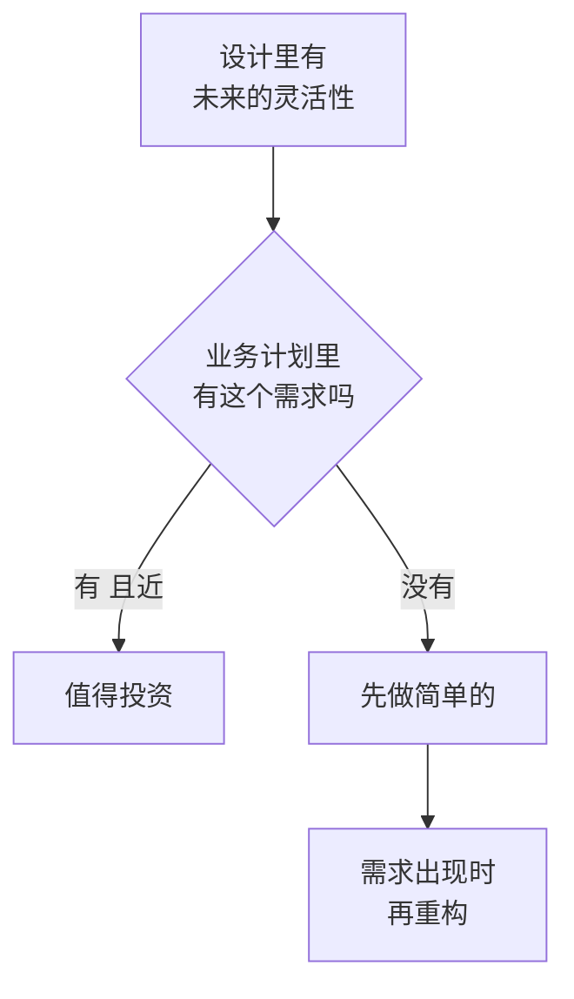

## Q
**Over-engineering · 为未来设计的代价**｜原则 · 加分

同事的设计里有一个可插拔的插件框架、三层抽象、支持十种存储后端，而产品现在只有一种后端、一个客户。你在评审时怎么说？

## A
**原则：** 为想象中的未来设计，是要付**现在**的成本的。架构要对应业务**当前的痛点和已知的增长**，而不是最大的可能性。

**怎么做：**
1. **问业务路线图：** 要不要投资可扩展性，取决于计划。例子：两年内只加 Apple Pay，就不值得做通用的支付方式框架；一年内要加 10 种，就值得，把一个月缩到几天。
2. **区分两种 scalability：** 新业务用例的增长，和数据、流量的增长；各自有自己的触发条件。
3. **从简单开始：** 用白板、方框和箭头，用简单的语言写文档；不要为了形式引入 UML 之类的重框架，除非你确信它有价值且团队理解。
4. **简单的架构更容易被所有人理解**，包括初级工程师，因此能得到更多反馈。
5. **复杂容易，简单难：** 能把方案用几张图讲清楚，往往比画出复杂架构更难。
6. **good enough：** 架构随时可以改，只是改动更贵，所以谨慎对待单向门，其余先做够用的。

**常见错法：**
- **"以后可能用到"：** 没有任何计划支持。
- **用术语显示水平：** 阻碍大家参与评审。
- **完美主义：** 追求"理想架构"而让交付拖慢。

**回到题目：** "现在有几种后端、几个客户？路线图上哪个季度会需要第二种后端？如果没有，先抽象成一个接口就够，插件框架等第二个需求出现再做。"把这个意见写进评审评论，并提出触发条件。

**面试官在考什么：** 你有没有克制，也有没有商业意识：复杂度是要被业务需求买单的。

**适合配哪类故事：** 你推动简化了一个过度复杂的设计，或在评审中把"未来可能"换成"何时需要"的触发条件的经历。

**出处：** Orosz《The Software Engineer's Guidebook》ch25 §1 "Keep It As Simple As Possible"；§6 "Scalable Architecture"（支付方式框架例子）；§7 "Architecture Decisions vs Business Priorities"
