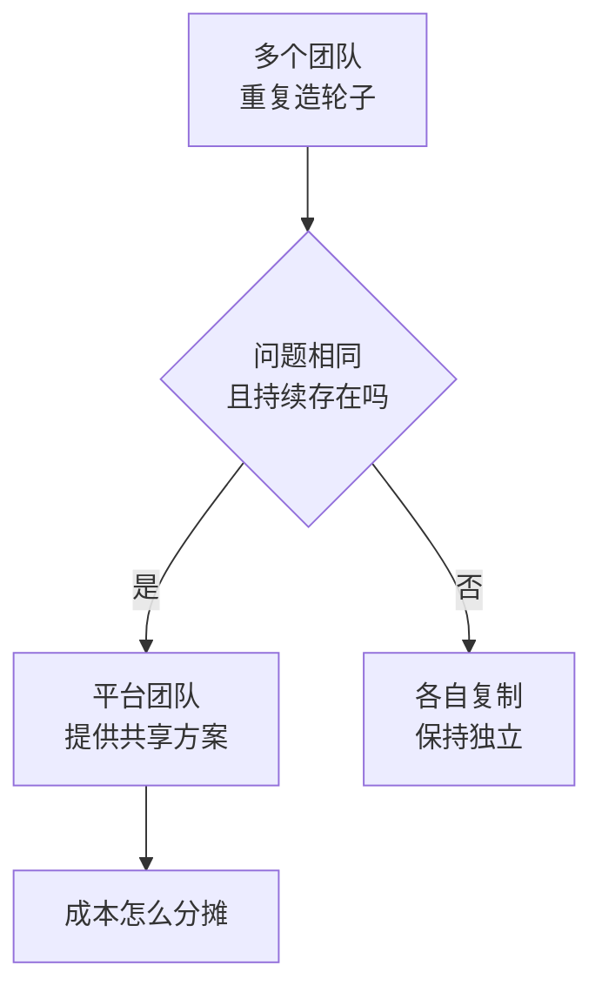

## Q
**Platform economics · 共享还是复制**｜原则 · 加分

三个业务团队各自写了一套"发通知"的代码，差异不大。有人提议成立一个平台团队统一做，也有人说"复制一份改改更快"。你怎么判断什么时候该抽成共享组件？

## A
**原则：** 共享组件**把成本集中、把收益分摊**，但也引入协调、兼容和归属的成本。该抽的信号是：**多个团队在解同一个问题，而且需求真实、稳定**；没有这样的信号，复制往往更省。

**怎么做：**
1. **看形成平台团队的典型原因：** 多个产品团队开始各自解决存储、基础设施或支付这类问题；由专门团队提供一个方案，避免重复，也让其他人更轻松。
2. **平台的特征：** 技术使命、内部客户、多个团队使用。客户是别的工程师，要像对待客户一样对待。
3. **只为已知的需求建抽象：** 支付例子：做一个通用框架要几个月，但把加一个支付方式从一个月缩到几天；只有路线图上有十种渠道才值得，只加一个就不值得。
4. **想好成本分摊：** Larson 的案例里，平台成本按业务单元收入比例分摊，核心业务承担大部分，于是有压力削减平台开支，而平台团队的负担却随新业务增加。分摊方式会影响行为。
5. **小心共享的爆炸半径：** 一个共享单体里一个业务单元的不负责任可能影响所有人；但服务多了，基础设施的负担也更大。两头都有成本，要按细节判断。

**常见错法：**
- **为了"复用"而抽象：** 只有一个调用方时就做通用框架。
- **没有归属：** 共享组件没人维护。
- **平台团队不管客户体验：** 没人愿意用，大家又各自复制。

**回到题目：** 先看三份代码的差异是不是真的小、以后会不会继续有第四个团队；若是，先做一个薄的共享库，由一个团队负责，用户反馈驱动；若差异大、归属不清，就继续复制，只记录它们的共同点。

面试官看什么 · 配哪类故事 · 出处

**面试官在考什么：** 你对共享与复制的成本有清楚的认识，并且考虑到组织和成本分摊。

**适合配哪类故事：** 你推动（或阻止）了一个共享组件或平台，并以具体的使用者和成本来论证的经历。

**出处：** Orosz《The Software Engineer's Guidebook》ch5 §2 "Platform Teams"；ch25 §6 "Scalable Architecture"（支付方式框架例）；Larson《Crafting Engineering Strategy》ch20 Document 20-1（平台成本分摊与服务数量的取舍）

